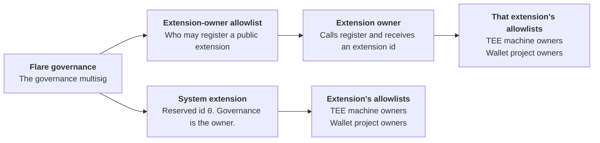

The `FlareTeeManager` keeps three allowlists on `OwnerAllowlistFacet`:

- **Global extension owners.** Flare governance decides who may register a public extension.
- **Per-extension TEE machine owners.** The extension owner decides who may register a TEE machine on that extension.
- **Per-extension wallet project owners.** The extension owner decides who may create a wallet project on that extension.

The public interface is [`IOwnerAllowlist`](/fcc/reference/IOwnerAllowlist).
Registration checks the relevant list at call time.

This diagram shows the relationships between the allowlists.

| Who updates it   | Allowlist                                                              |
| ---------------- | ---------------------------------------------------------------------- |
| Flare governance | Global extension owners.                                               |
| Extension owner  | Extension's TEE machine owners, and extension's wallet project owners. |

Each list also has an allow-all flag.
While the flag is true, the address list is skipped, and any address is treated as allowed.
The `disallowAll*` flag turns the list back on and leaves the stored addresses in place.

## Extension Owners

The extension owner allowlist is global.
Flare governance adds addresses with [`addAllowedExtensionOwners`](/fcc/reference/IOwnerAllowlist#addallowedextensionowners) and removes them with [`removeAllowedExtensionOwners`](/fcc/reference/IOwnerAllowlist#removeallowedextensionowners) functions.
The [`allowAllExtensionOwners`](/fcc/reference/IOwnerAllowlist#allowallextensionowners) function opens public extension registration to every address.
The [`disallowAllExtensionOwners`](/fcc/reference/IOwnerAllowlist#disallowallextensionowners) function closes it again.

An address may call [`register`](/fcc/reference/IExtensionManager#register) when [`isAllowedExtensionOwner`](/fcc/reference/IOwnerAllowlist#isallowedextensionowner) returns true.
That call is true when the address is on the list, or when [`allExtensionOwnersAllowed`](/fcc/reference/IOwnerAllowlist#allextensionownersallowed) is true.
The same check applies when someone proposes a new owner for a public extension.
Public registration assigns ids from `65536` upward.
Id 0 is the system extension, and ids 1 through 65535 are reserved for governance to mint with [`registerReserved`](/fcc/reference/IExtensionManager#registerreserved), so a public id stays outside that range.

## TEE Machine Owners

Each extension has its own machine owner list.
The extension owner adds addresses with [`addAllowedTeeMachineOwners`](/fcc/reference/IOwnerAllowlist#addallowedteemachineowners) and removes them with [`removeAllowedTeeMachineOwners`](/fcc/reference/IOwnerAllowlist#removeallowedteemachineowners), or opens that extension with [`allowAllTeeMachineOwners`](/fcc/reference/IOwnerAllowlist#allowallteemachineowners).
An allowed address may call [`IMachineManager.register`](/fcc/reference/IMachineManager#register) and may receive ownership of a machine on that extension.

The `fce deploy` command calls `addAllowedTeeMachineOwners` for the deployer after `register` succeeds.
A later `fce run` from that same account can register a machine.
A different account needs the extension owner to allow it first.

## Wallet Project Owners

Wallet project owners are a separate list on the same extension.
The extension owner adds addresses with [`addAllowedTeeWalletProjectOwners`](/fcc/reference/IOwnerAllowlist#addallowedteewalletprojectowners), or opens that to the extension with [`allowAllTeeWalletProjectOwners`](/fcc/reference/IOwnerAllowlist#allowallteewalletprojectowners).
An allowed address may call [`createProject`](/fcc/reference/IWalletProjectManager#createproject).
The [Wallets](/fcc/guides/wallets-extension) guide starts with this call.
The machine-owner flag and the wallet project flag are independent, and so are their address lists.

## System Extension

The system extension is owned by Flare governance.
The [`getExtensionOwner(0)`](/fcc/reference/IExtensionManager#getextensionowner) function returns `governance()`, the governance multisig address.
Its id is 0.
It is never registered with `register`, and `proposeNewOwner` and `setExtensionContracts` revert with [`SystemOwnedExtensionId`](/fcc/reference/IExtensionManager#systemownedextensionid).

Governance is this extension's owner, so governance updates its TEE machine-owner list and its wallet-project-owner list.

Governance mints ids `1` through `65535` with [`registerReserved`](/fcc/reference/IExtensionManager#registerreserved) and chooses the initial owner in that call.
A later ownership transfer of a reserved or public extension requires the new owner to pass the global extension-owner allowlist.

## TEE Signer Set

The `fce governance` command records the TEE signer addresses and threshold for one extension.
A machine attests to that governance hash when it registers.
Flare governance is the address `governance()` returns on `FlareTeeManager`.
That address updates the global extension-owner allowlist, and it owns the system extension.

:::tip[What's next]
To learn more about the Flare Confidential Compute system, read [Flare Confidential Compute](/fcc/overview).
Start with [Build Your First Extension](/fcc/guides/getting-started), and deploy an extension with [Deploy a TEE on Google Cloud](/fcc/guides/deploy-on-gcp).
:::
