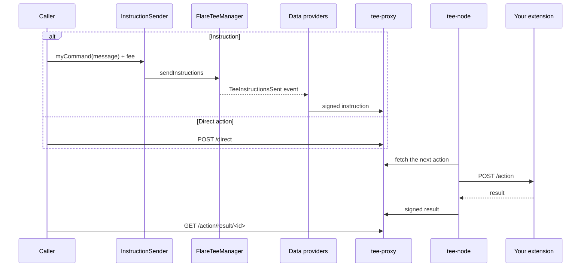

import CodeBlock from "@theme/CodeBlock";
import MainGo from "!!raw-loader!/examples/developer-hub-fcc-scaffold/template/cmd/extension/main.go";
import AppGo from "!!raw-loader!/examples/developer-hub-fcc-scaffold/template/internal/app/app.go";
import MyCommandGo from "!!raw-loader!/examples/developer-hub-fcc-scaffold/template/internal/app/mycommand.go";
import MyDirectCommandGo from "!!raw-loader!/examples/developer-hub-fcc-scaffold/template/internal/app/mydirectcommand.go";
import InstructionSender from "!!raw-loader!/examples/developer-hub-fcc-scaffold/template/contracts/src/InstructionSender.sol";
import DeployScript from "!!raw-loader!/examples/developer-hub-fcc-scaffold/template/contracts/script/Deploy.s.sol";
import ExtensionBase from "!!raw-loader!/examples/developer-hub-fcc-scaffold/sol/src/ExtensionBase.sol";

This guide builds your first **Flare Confidential Compute (FCC)** extension from the template in the [FCE Go scaffold](https://github.com/flare-foundation/fce-go-scaffold).
You deploy it to **Coston2** with [`fce`](https://github.com/flare-foundation/fce-tooling), the FCC extension CLI, then run a test machine and send it work.

For background on FCC and Flare Compute Extensions (FCE), see the [FCC overview](/fcc/overview).

:::info[What you will build]
A Go program that runs inside a Trusted Execution Environment (TEE) image, next to `tee-node`, plus the Solidity contract that sends it instructions.
The template has one operation on each channel: an **instruction** that a caller sends through your contract onchain, and a **direct action** that a client posts straight to the TEE's proxy.
:::

:::warning[Work in progress]
FCC is in the final stages of development, and the scaffold and `fce` are still evolving.
Use Coston2 for everything in this guide, and expect interfaces to change.
:::

## How an Extension Works

An extension never talks to the chain directly.
It runs in one image with `tee-node`, which holds the TEE's key, talks to the outside world, and signs every result.
`tee-node` pulls work from **`tee-proxy`**, a public server that queues actions and stores results.

Work reaches the extension in one of two ways:



Instructions only reach the TEE after data providers sign them with more than 50% of the signing policy's weight.
See [Data providers and cosigners](/fcc/data-providers) and [TEE public and private keys](/fcc/tee-keys).

You write two things: the handlers in Go, and the entrypoint contract in Solidity.
The scaffold's library handles the HTTP wiring to `tee-node`, strict payload decoding, and calls to the TEE key.
The shared `ExtensionBase` contract handles sending, fees, and checking TEE signatures.

## Prerequisites

- [Go](https://go.dev/dl/) 1.27.4 or newer, and `gcc` for the tests that run with cgo.
- [Foundry](https://getfoundry.sh/) 1.7.1 or newer (`forge`, `cast`).
- [Docker](https://docs.docker.com/get-docker/) with buildx and Compose.
  The stack runs as `linux/amd64`.
  On Apple Silicon, Docker emulates it, which is slow but fine for a test machine.
- A Coston2 account funded from the [Coston2 faucet](https://faucet.flare.network/coston2).
  It pays for gas, extension registration, and machine registration and availability check fees.

:::danger[Use a test-only key]
`fce` signs transactions with the keystore you give it, and the `make` targets build and run code.
Use a key that holds only test funds.
Install the scaffold and `fce` only from the [`flare-foundation`](https://github.com/flare-foundation) GitHub organization.
:::

## Step 1: Install `fce` Tooling

Clone the tooling repository and install the CLI:

```bash
git clone https://github.com/flare-foundation/fce-tooling.git
cd fce-tooling
go install ./cmd/fce
fce version
```

`go install` puts `fce` in `GOBIN`, or `GOPATH/bin` if `GOBIN` is unset, so keep that directory on your `PATH`.
A build from a release tag with no local changes reports that version.
Any other build is a development build, and `fce` prints a warning when it uses one.

## Step 2: Fork the Scaffold

Fork [`fce-go-scaffold`](https://github.com/flare-foundation/fce-go-scaffold) on GitHub, then clone your fork:

```bash
git clone https://github.com/<your-account>/fce-go-scaffold.git
cd fce-go-scaffold
```

Your fork changes only `template/` (and `examples/`, if you build on one).
Leave the shared parts alone: `pkg/`, `sol/`, `conformance/`, `internal/`, `launcher/`, `docs/`, `fce-version`, the `Makefile`, and the lint and agent files.
You get fixes to those by merging upstream, and local edits there cause merge conflicts.
The scaffold's [forking guide](https://github.com/flare-foundation/fce-go-scaffold/blob/main/docs/fork.md) covers optional renames, such as the Go module path.

## Step 3: Import Your Deployer Key

`fce` signs with a key from a Foundry keystore, so the private key never appears in a command argument or an environment variable.
Import your funded Coston2 key once:

```bash
cast wallet import coston2-deployer --interactive
cast wallet address --account coston2-deployer
```

This guide uses `coston2-deployer` as the account name.
`fce` asks for the keystore password each time it signs, or reads it from a file passed with `-password-file`.

## Template Layout

| Path                             | What it is                                                       |
| -------------------------------- | ---------------------------------------------------------------- |
| `template/cmd/extension/main.go` | The entrypoint: reads the environment, registers ops, serves     |
| `template/internal/app/`         | Your code: op constants, handlers, state, and their tests        |
| `template/conformance/`          | Golden fixtures for your ops, generated from the Go tests        |
| `template/contracts/`            | The entrypoint contract, its deploy scripts, and its forge tests |
| `template/Dockerfile`            | The reproducible TEE image: launcher, `tee-node`, and extension  |

The template's operations:

| Operation type | Operation command   | Channel     | Payload                                     | Result                     |
| -------------- | ------------------- | ----------- | ------------------------------------------- | -------------------------- |
| `MY_EXTENSION` | `MY_COMMAND`        | Instruction | `abi.encode(address sender, bytes message)` | The same pair, ABI-encoded |
| `MY_EXTENSION` | `MY_DIRECT_COMMAND` | Direct      | JSON `{"message": "…"}`                     | The same JSON              |

### Entrypoint Go Code

`main.go` reads the environment that the launcher passes in, registers the handlers, and serves `tee-node` until it is stopped.
Read your own environment variables where the `TODO` is.

<details>
  <summary>View `main.go`</summary>
  <CodeBlock language="go" title="template/cmd/extension/main.go">
    {MainGo}
  </CodeBlock>
</details>

### Operations and Registration

An operation is a pair: an **operation type**, which groups commands, and an **operation command**, which is a verb.
Each pair belongs to exactly one channel, either instruction or direct, never both.

<details>
  <summary>View `app.go`</summary>
  <CodeBlock language="go" title="template/internal/app/app.go">
    {AppGo}
  </CodeBlock>
</details>

Registration panics on a mistake: a pair registered twice, an operation type that starts with `F_` (reserved for Flare system operations), or a name longer than 32 bytes.

### Instruction Operation Handler

`tee-node` does not pass the caller's address to the extension.
If you need it, your contract has to encode `msg.sender` into the payload, which is what the template does.

<details>
  <summary>View `mycommand.go`</summary>
  <CodeBlock language="go" title="template/internal/app/mycommand.go">
    {MyCommandGo}
  </CodeBlock>
</details>

A handler returns one of three things:

| It returns       | The action gets                                                          |
| ---------------- | ------------------------------------------------------------------------ |
| An error         | `status 0` at once, with `error: <text>` as the public log               |
| Data             | `status 1` at once                                                       |
| Data and a `Run` | `status 2` (pending) at once, then the `Run` continues in the background |

A handler has 1.5 seconds to answer; `tee-node` waits 2 seconds in total.
Anything slower needs the long-running mode, which the [External API guide](/fcc/guides/external-api-extension) shows.

Wrap any error that could carry a secret in `extension.PublicError("...", err)`.
Only the first argument reaches the public log.

:::warning[Instructions can arrive more than once]
`tee-node` does not remember instructions.
An operator can deliver one again, or deliver it after a newer one.
Make each handler idempotent or reject replays.
When order matters, number the instructions in the contract, as the [Direct Actions guide](/fcc/guides/direct-actions-extension) does.
:::

### Direct Action Handler

A direct action reaches the extension only through the proxy.
There is no fee and no data provider signature, so nothing vouches for the sender.

<details>
  <summary>View `mydirectcommand.go`</summary>
  <CodeBlock language="go" title="template/internal/app/mydirectcommand.go">
    {MyDirectCommandGo}
  </CodeBlock>
</details>

Decode payloads with `pkg/payload`.
`payload.DecodeABI` accepts only the canonical ABI encoding, and `payload.DecodeJSON` rejects unknown fields and trailing data.

### Entrypoint Contract

The `InstructionSender` contract is the only onchain entry point for your instructions.
It inherits `ExtensionBase`, which binds the extension ID, charges fees, sends instructions through `FlareTeeManager`, and checks TEE signatures.

<details>
  <summary>View `InstructionSender.sol`</summary>
  <CodeBlock
    language="solidity"
    title="template/contracts/src/InstructionSender.sol"
  >
    {InstructionSender}
  </CodeBlock>
</details>

- Solidity's `bytes32("MY_EXTENSION")` and Go's `op.Type("MY_EXTENSION").Hash()` produce the same bytes, so the names must match exactly.
- Write one payable send function per instruction command and add the `chargesFees` modifier to it.
- Direct commands have no function in the contract.
  Clients post them to the proxy instead.

<details>
  <summary>View `ExtensionBase.sol`</summary>
  <CodeBlock language="solidity" title="sol/src/ExtensionBase.sol">
    {ExtensionBase}
  </CodeBlock>
</details>

The price of an instruction is the **protocol fee**, which governance sets per operation pair and charges per TEE, plus an optional **project fee**, which the contract owner sets with `setProjectFee`.
[`quoteFee(opType, opCommand)`](/fcc/instruction-fees#quotefee) returns the price for one TEE.

The deploy script finds `FlareTeeManager` in the [Flare contract registry](/network/guides/flare-contracts-registry), so no address is hardcoded:

<details>
  <summary>View `Deploy.s.sol`</summary>
  <CodeBlock language="solidity" title="template/contracts/script/Deploy.s.sol">
    {DeployScript}
  </CodeBlock>
</details>

## Step 4: Test Locally

Run the Go handler tests, then check the extension from the outside with `fce conformance` command:

```bash
go test ./template/...
fce conformance ./template
```

`fce conformance` builds the binary as the image does and starts it against a fake sign port.
It then sends each fixture in `template/conformance/` the way `tee-node` would, and runs the checks every extension must pass.
`make test` also runs the contract's forge tests.
The forge tests read the same `my-command.json` fixture, so the contract and the handler cannot drift apart.

`fce image-check ./template` builds the image and checks its Dockerfile, its config, and the binaries it runs, then does a smoke run.

## Step 5: Deploy and Register

```bash
fce deploy -chain coston2 -account coston2-deployer ./template
```

`fce deploy` does four things:

1. Deploys `InstructionSender` smart contract with `contracts/script/Deploy.s.sol` script.
2. Registers it with `FlareTeeManager` (`ExtensionManager.register`), which returns your **extension ID**.
3. Allows the deployer to own the extension's machines.
4. Runs `contracts/script/PostRegister.s.sol` script, which calls `setExtensionId` on the contract.

It records the result in `template/deployments/coston2.json`: the chain, `FlareTeeManager`, your contract addresses, the extension ID, and everything later commands add.
Commit this file, because it publishes your extension's addresses alongside its code.
If you run `fce deploy` again, it finishes any remaining steps and does nothing once they're all done.

:::note[Who owns what]
The deployer ends up owning both the contract (project fee, withdrawals) and the extension in the registry.
Registry ownership matters more: it decides which code hashes the extension's machines can run.
Before production, secure that key or move both roles to a multisig.
:::

## Step 6: Allow a Test Version and Set Governance

A test machine runs `tee-node` in test mode, so the extension must allow `tee-node`'s fixed test code hash.
It also needs governance: the signers that govern its machines.
For a test, use your deployer address as the only signer:

```bash
fce add-version -chain coston2 -account coston2-deployer -test ./template
fce governance -chain coston2 -account coston2-deployer \
  -signers "$(cast wallet address --account coston2-deployer)" -threshold 1 ./template
fce status -chain coston2 ./template
```

`fce status` compares your deployment record with the chain.

:::danger[The test hash is not a TEE]
Test machines have no TEE, and their operators hold their keys, yet contracts accept their signatures as the extension's.
Only allow the test version on an extension that real users don't use.
Otherwise, disable it with `fce disable-version -test` before users arrive.
Disabling is permanent.
:::

## Step 7: Run a Test Machine

```bash
fce run -chain coston2 -account coston2-deployer ./template
```

`fce run` takes a machine from nothing to production:

1. Checks the chain, builds the image with `make image`, and starts `tee-node`, `tee-proxy`, and Redis with Docker Compose.
2. Opens a Cloudflare quick tunnel so data providers and the availability check can reach the proxy.
   Use `-url` to provide your own public URL instead.
3. Registers the machine, which attests to a challenge from the chain, and waits for the attestation result.
4. Asks one of the system's machines to check that yours is available.
5. Moves the machine to production and prints a line like this:

   ```text
   machine 0x… of extension <id> is in production at https://….trycloudflare.com
   ```

Registration and the availability check charge fees, and each step pays gas.
Each start of `tee-node` generates a new key, so each run registers a new machine.

By default, `tee-proxy` reads signing policies and voters through Coston2's public RPC.
That is fine for a test machine, but the proxy then trusts the RPC's answers.
To read them from a Flare C-chain indexer database instead, pass `-indexer-db` with a TOML file containing `host`, `port`, `database`, `username`, and `password`.

`fce run` stays attached and shows the logs.
Use `-detach` to return once the machine is in production, then stop it later with `fce stop`.

## Step 8: Send an Instruction and a Direct Action

From a second terminal, send `MY_COMMAND` through your contract with the message `hello`:

```bash
fce send -chain coston2 -account coston2-deployer ./template 'myCommand(bytes)' 0x68656c6c6f
```

`fce send` finds the fee by simulating the call, sends the transaction, then polls the proxy of each TEE the instruction went to.
It checks both the TEE's and the proxy's signatures and prints the result:

```text
instruction 0x…: MY_EXTENSION MY_COMMAND
      status 1 (ok), … after sending
      data 0x…
```

The data is `abi.encode(sender, message)`, which echoes your address and `hello`.

Post `MY_DIRECT_COMMAND` with `{"message":"hello"}` as hex:

```bash
fce direct -chain coston2 ./template MY_EXTENSION MY_DIRECT_COMMAND 0x7b226d657373616765223a2268656c6c6f227d
```

`fce direct` uses the proxy API key that `fce run` generated.
To post a direct action yourself, send `POST /direct` to the proxy with the API key in an `X-Api-Key` header:

```json
{
  "opType": "0x4d595f455854454e53494f4e0000000000000000000000000000000000000000",
  "opCommand": "0x4d595f4449524543545f434f4d4d414e44000000000000000000000000000000",
  "message": "0x7b226d657373616765223a2268656c6c6f227d"
}
```

The op type and command are `bytes32` names, and the message is hex.
Read the result at `GET /action/result/<id>?submissionTag=submit`.

## Step 9: Stop the Machine

Press **Ctrl-C** in the `fce run` terminal.
`fce` pauses the machine onchain and then removes the stack.
Pausing comes first because a machine stays in production after it stops running, and sends would keep going to it.

If pausing fails, `fce` keeps the run's state, and `fce stop` tries again.
`fce run` refuses to start a new machine until the old one is paused.

## Make It Your Own

1. **Rename the op.**
   Pick op type and command names for your own domain.
   Do not use the `F_` prefix or reuse a system command name (see [reserved names](/fcc/troubleshooting#instructions-never-reach-your-extension)).
   Change the constants in `app.go` and the `bytes32` constants in `InstructionSender.sol` together.
2. **Write the handler.**
   Decode strictly, validate everything before the first write, and synchronize shared state yourself.
   The library does not serialize calls, so an instruction, a direct action, and `GET /state` can all run at once.
3. **Add a send function** with `chargesFees` for each instruction command.
4. **Regenerate the fixtures** with `go test ./template/internal/app -update`, then run `make test` and `fce conformance ./template`.
5. **Name the image.**
   Set `org.opencontainers.image.title` and `org.opencontainers.image.version` in `template/Dockerfile`.
   The version label is part of the image hash.
6. **Redeploy the code.**
   Each `fce run` builds the image again, so a new run picks up your changes.

The scaffold's [extension guide](https://github.com/flare-foundation/fce-go-scaffold/blob/main/docs/extension-guide.md) covers errors, long-running jobs, state, the TEE key, wallet keys, and your own environment variables in depth.
The [rules](https://github.com/flare-foundation/fce-go-scaffold/blob/main/docs/rules.md) list every requirement an extension must meet, with what enforces it.

:::tip[Other languages]
The scaffold's library is Go, but the wire protocol between `tee-node` and the extension is language-agnostic.
The [extension contract](https://github.com/flare-foundation/fce-go-scaffold/blob/main/docs/extension-contract.md) defines it, and `fce conformance [flags] -- command [args...]` checks any binary against it.
:::

## Going to Production

Test machines are for development.
A production machine runs the attested image on a Confidential Space VM (`GCP_AMD_SEV` or `GCP_INTEL_TDX`):

```bash
fce add-version -chain coston2 -account coston2-deployer -platform GCP_AMD_SEV,GCP_INTEL_TDX ./template
```

`fce add-version` builds the image reproducibly and allows its config digest, under the image's version label, on the platforms you name.
Commit your changes first so that anyone can rebuild the same hash from your fork.
List every platform you will use now: you cannot add a platform to a hash later, so adding one means bumping the version label.

`fce` registers test machines.
[Deploy a TEE on Google Cloud](/fcc/guides/deploy-on-gcp) starts the same image on a Confidential Space VM, with tee-proxy and a C-chain indexer, and registers that machine on `FlareTeeManager`.

:::tip[What's Next]

Try continue building with Flare Confidential Compute follow these guides:

- [Deploy a TEE on Google Cloud](/fcc/guides/deploy-on-gcp): run the allowed image on a Confidential Space VM with tee-proxy and a C-chain indexer.
- [External API Extension](/fcc/guides/external-api-extension): call web APIs over TLS, return partial results past the 2-second limit, and verify a TEE-signed price onchain.
- [Direct Actions Extension](/fcc/guides/direct-actions-extension): provision secrets encrypted to the TEE, protect against replays, run a sealed-bid auction, and report state that a contract verifies.
- [Wallets Extension](/fcc/guides/wallets-extension): sign EVM transactions with wallet keys that `tee-node` generates and keeps inside the TEE.
- [FCC Troubleshooting](/fcc/troubleshooting): common `fce` and machine issues.
  :::
