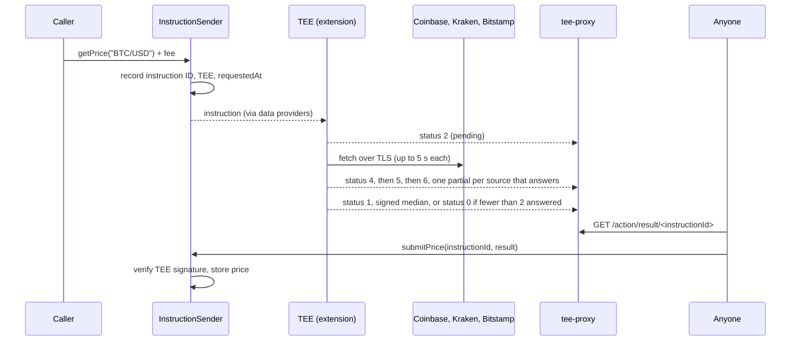

import CodeBlock from "@theme/CodeBlock";
import MainGo from "!!raw-loader!/examples/developer-hub-fcc-scaffold/examples/external-api/cmd/extension/main.go";
import AppGo from "!!raw-loader!/examples/developer-hub-fcc-scaffold/examples/external-api/internal/app/app.go";
import GetPriceGo from "!!raw-loader!/examples/developer-hub-fcc-scaffold/examples/external-api/internal/app/getprice.go";
import SourcesGo from "!!raw-loader!/examples/developer-hub-fcc-scaffold/examples/external-api/internal/app/sources.go";
import InstructionSender from "!!raw-loader!/examples/developer-hub-fcc-scaffold/examples/external-api/contracts/src/InstructionSender.sol";

This guide walks through the [`external-api`](https://github.com/flare-foundation/fce-go-scaffold/tree/main/examples/external-api) example from the FCE Go scaffold.
The extension fetches a price from three public APIs inside the TEE and posts each source's answer as it arrives.
It then signs the median with the TEE key, and the contract verifies that signature before storing the price.

:::tip[New to FCC extensions?]
Start with [Build Your First Extension](/fcc/guides/getting-started).
It covers installing `fce`, the template, and the deploy and run flow that this guide reuses.
:::

It shows three patterns that most data-fetching extensions need:

- **Calling outside services over TLS** from a TEE whose operator controls the network.
- **Long-running work**: answering past `tee-node`'s 2-second limit, with partial results along the way.
- **Putting a TEE's answer onchain**: signing a message of your own and having the contract check it.

:::warning[An example, not a production oracle]
One TEE answers each request, and its operator sees the price first and can withhold it.
A stored price may already be 10 minutes old by the time the contract stores it.
For production price feeds on Flare, use the [FTSO](/ftso/overview).
:::

## Overview

Here is a summary of the extension's operations:

| Op type  | Op command         | Channel     | Payload                   | Partial results                            | Final result                                                                             |
| -------- | ------------------ | ----------- | ------------------------- | ------------------------------------------ | ---------------------------------------------------------------------------------------- |
| `PRICES` | `GET_PRICE`        | Instruction | `abi.encode(string pair)` | `abi.encode(string source, uint256 price)` | `abi.encode(string pair, uint256 price, uint8 decimals, uint8 sources, bytes signature)` |
| `PRICES` | `GET_PRICE_DIRECT` | Direct      | JSON `{"pair"}`           | JSON `{"source", "price"}`                 | JSON `{"pair", "price", "decimals", "sources"}` (unsigned)                               |

The supported pairs are `BTC/USD`, `ETH/USD`, and `FLR/USD`.
Prices are integers with 8 decimals.
The `sources` field counts how many APIs answered.

The flow for `GET_PRICE`:



## Statuses

Every result has a status from `0` to `255` and a public log.
`GET_PRICE` and `GET_PRICE_DIRECT` use the same numbers.
`tee-proxy` keeps one result per action.
Status `0` and status `1` are final and replace whatever is stored, so status `1` replaces status `6`.
A status of `2` or higher is replaced only by a higher status or by a final one.

| Status    | Log             | Meaning                                                                                             |
| --------- | --------------- | --------------------------------------------------------------------------------------------------- |
| `0`       | `error: <text>` | Failed, and final. `data` is empty.                                                                 |
| `1`       | `ok`            | Succeeded, and final. `data` is the price to submit.                                                |
| `2`       | `pending`       | Accepted. The fetch continues in the background.                                                    |
| `3`       | set by the node | Posted by `tee-node` when `POST /action` takes longer than 2 seconds.                               |
| `4`–`255` | `partial`       | One partial per source that answered, in arrival order. This example posts `4`, then `5`, then `6`. |

Status `0` before any fetch means `unknown pair`, `invalid payload`, or, on `GET_PRICE` only, `instruction already answered`.
Fewer than two sources answering ends the job as status `0` with `error: too few sources answered`.
A partial's `data` is that source's name and price.
Status `1`'s `data` is the signed median for `GET_PRICE`, and the unsigned JSON median for `GET_PRICE_DIRECT`.
If the TEE restarts after status `2`, the proxy keeps the last status, so time it out yourself.

## Trusting the Sources

The sources are fixed in the code, so they are part of the attested image.
Anyone who rebuilds the image can see which APIs the TEE trusts, and the operator cannot point it anywhere else.

<details>
  <summary>View `sources.go`</summary>
  <CodeBlock
    language="go"
    title="examples/external-api/internal/app/sources.go"
  >
    {SourcesGo}
  </CodeBlock>
</details>

The operator runs the machine and its network, so the extension treats every answer as hostile until it has checked it:

- It uses only `https` URLs, verified against the CA bundle in the attested image.
- It follows no redirects, so a source cannot send the TEE to another host or off TLS.
- It caps each answer at 64 KiB and requires a positive decimal price.
- If a source fails, the extension leaves it out and keeps the error internal, because logs are public.
- The median needs two of the three sources.
  One of the three may be down or wrong.
- The caller picks a pair from a fixed list, so caller input never reaches a URL.

## Long-Running Results

Three HTTP requests can take longer than `tee-node`'s 2 seconds, so the handler returns a `Run` and the action is [status `2`](#statuses) at once.
The `Run` fetches in the background.

The long-running mode posts results through `tee-node`'s sign port, so `main.go` passes `extension.WithSignPort`.
It also passes a `node.Client` that the handler uses to sign with the TEE key:

<details>
  <summary>View `main.go`</summary>
  <CodeBlock language="go" title="examples/external-api/cmd/extension/main.go">
    {MainGo}
  </CodeBlock>
</details>

<details>
  <summary>View `app.go`</summary>
  <CodeBlock language="go" title="examples/external-api/internal/app/app.go">
    {AppGo}
  </CodeBlock>
</details>

Inside the `Run`, each `prog.Post` publishes the next partial, from status `4` up, in the order the sources answer.
The bytes the `Run` returns become the final result: status `1`, or status `0` with `error: too few sources answered`.

<details>
  <summary>View `getprice.go`</summary>
  <CodeBlock
    language="go"
    title="examples/external-api/internal/app/getprice.go"
  >
    {GetPriceGo}
  </CodeBlock>
</details>

Points to note:

- **Bound the job yourself.**
  The library limits neither how long a job runs nor how many run at once.
  The example bounds each source with a 5-second timeout.
- **Time out a result that stays below status `1`.**
  If the TEE restarts mid-job, it posts no final status, and the proxy keeps the last one.
- **Answer each instruction once.**
  `getPrice` refuses an instruction ID it has already answered.
  Otherwise, an operator could deliver the same instruction again, fetch again, and submit whichever price it prefers.

## Putting the Price Onchain

The TEE signs its final answer through the sign port (`SignTEE`, [EIP-191](https://eips.ethereum.org/EIPS/eip-191) over the message's keccak256):

```text
abi.encode(bytes32 "PRICES_PRICE_V1", bytes32 instructionId, keccak256(abi.encode(pair, price, decimals, sources)))
```

- **`PRICES_PRICE_V1`** is a tag of the extension's own.
  It keeps this signature from meaning anything else, such as one of `tee-node`'s own signatures.
- **`instructionId`** binds the signature to one request, on one chain, at one contract.
  The ID arrives with the instruction, signed by the data providers, and the contract accepts it only once.
  So the extension doesn't need a chain ID.
- **`V` must be 27 or 28.**
  The signature's last byte, `V`, tells `ecrecover` which of the two possible keys signed.
  The sign port returns that byte as `0` or `1`.
  `ecrecover` only accepts `27` or `28`, so the extension adds 27 before it packs the signature into the result.

:::warning[Never sign bytes a user chooses]
`SignTEE` signs in the same domain as `tee-node`'s own signatures.
Always build the message yourself in a format only your extension uses, and encode it with `abi.encode`, never by concatenating variable-length fields.
:::

The contract records each request in `getPrice`, then verifies the result in `submitPrice`:

<details>
  <summary>View `InstructionSender.sol`</summary>
  <CodeBlock
    language="solidity"
    title="examples/external-api/contracts/src/InstructionSender.sol"
  >
    {InstructionSender}
  </CodeBlock>
</details>

`submitPrice` stores the price only if all of the following hold:

- The contract requested that instruction, and nobody has submitted an answer to it yet.
- The submission comes no more than `MAX_PRICE_DELAY` (10 minutes) after the request, by block time.
- The pair is the one requested.
- `_teeSigner` recovers the TEE the request went to, and that TEE is a production machine of this extension.
  The extension must also not be emergency-paused.

`_teeSigner` comes from `ExtensionBase`.
It recovers the signer and asks `FlareTeeManager` whether that signer is a production TEE of this extension.

Nothing reaches the contract on its own.
Someone has to read the result from the proxy and call `submitPrice`: the caller, a keeper, or any other account, since the TEE signature is the proof.

## Run It on Coston2

Follow Steps 1 through 3 of [Build Your First Extension](/fcc/guides/getting-started) to install `fce`, fork the scaffold, and import a keystore account.
Then test and deploy `examples/external-api`:

```bash
go test ./examples/external-api/...
fce conformance ./examples/external-api

fce deploy -chain coston2 -account coston2-deployer ./examples/external-api
fce add-version -chain coston2 -account coston2-deployer -test ./examples/external-api
fce governance -chain coston2 -account coston2-deployer \
  -signers "$(cast wallet address --account coston2-deployer)" -threshold 1 ./examples/external-api
fce run -chain coston2 -account coston2-deployer ./examples/external-api
```

From a second terminal, request a price:

```bash
fce send -chain coston2 -account coston2-deployer ./examples/external-api 'getPrice(string)' 'BTC/USD'
```

`fce send` prints the instruction ID, then each [status](#statuses) as the proxy stores it: `2`, then a partial for each source, then status `1` and its signed `data`.
Submit that `data` to the contract within 10 minutes, then read the stored price:

```bash
SENDER=$(jq -r .instructionSender examples/external-api/deployments/coston2.json)
RPC=https://coston2-api.flare.network/ext/C/rpc

cast send --rpc-url "$RPC" --account coston2-deployer "$SENDER" \
  'submitPrice(bytes32,bytes)' <instructionId> <data>
cast call --rpc-url "$RPC" "$SENDER" 'latestPrice(string)((uint256,uint8,uint8,uint64))' 'BTC/USD'
```

The direct variant needs no fee and returns an unsigned answer:

```bash
fce direct -chain coston2 ./examples/external-api PRICES GET_PRICE_DIRECT \
  0x$(printf '{"pair":"ETH/USD"}' | xxd -p | tr -d '\n')
```

Its answer is unsigned because `tee-proxy` picks a direct action's ID.
A signed direct answer could pass as an instruction's answer.

Press **Ctrl-C** in the `fce run` terminal when you are done.

## Limits

- **Latency:** the instruction waits for data provider signatures, the sources take up to 5 seconds, and someone has to submit the result.
  This takes seconds even when everything goes well.
- **Freshness:** the bound is in chain time only.
  The TEE fetched the price at some point between the request block and the submission block, which are at most 10 minutes apart.
  Check `requestedAt`.
- **One TEE:** each request goes to one random TEE, whose operator can withhold the price.
  A stronger design sends the request to several TEEs and requires a quorum of signed answers.
- **Availability:** the contract accepts any production TEE of the extension, even one whose availability check has lapsed.
  If that matters to you, also check `getAvailabilityCheckValidity`.
- **Sources:** the example doesn't check the sources' own timestamps.

:::tip[What's next]

To learn more about FCC extensions, see:

- [Direct Actions Extension](/fcc/guides/direct-actions-extension): get an API key into the TEE as an encrypted, signed direct action instead of building it into the image.
- [TEE public and private keys](/fcc/tee-keys): how the TEE key signs results.
- The scaffold's [contracts guide](https://github.com/flare-foundation/fce-go-scaffold/blob/main/docs/contracts.md#8-consuming-results) on consuming results onchain.
  :::
