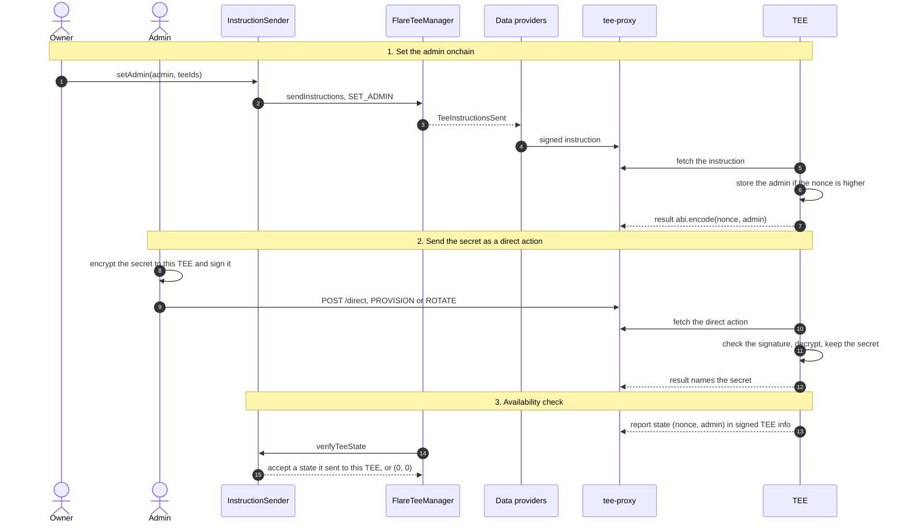
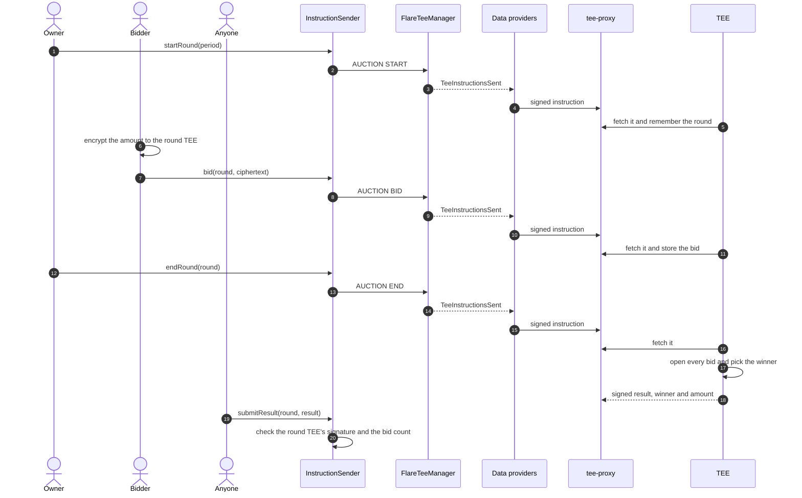

import CodeBlock from "@theme/CodeBlock";
import MainGo from "!!raw-loader!/examples/developer-hub-fcc-scaffold/examples/direct/cmd/extension/main.go";
import AppGo from "!!raw-loader!/examples/developer-hub-fcc-scaffold/examples/direct/internal/app/app.go";
import SetAdminGo from "!!raw-loader!/examples/developer-hub-fcc-scaffold/examples/direct/internal/app/setadmin.go";
import AdminGo from "!!raw-loader!/examples/developer-hub-fcc-scaffold/examples/direct/internal/app/admin.go";
import ProvisionGo from "!!raw-loader!/examples/developer-hub-fcc-scaffold/examples/direct/internal/app/provision.go";
import RotateGo from "!!raw-loader!/examples/developer-hub-fcc-scaffold/examples/direct/internal/app/rotate.go";
import ReportGo from "!!raw-loader!/examples/developer-hub-fcc-scaffold/examples/direct/internal/app/report.go";
import InstructionSender from "!!raw-loader!/examples/developer-hub-fcc-scaffold/examples/direct/contracts/src/InstructionSender.sol";

This guide walks through the [`direct`](https://github.com/flare-foundation/fce-go-scaffold/tree/main/examples/direct) example from the FCE Go scaffold.
It shows how to get a secret, such as an API key, into a TEE without putting it onchain or in the image.
It also shows how to keep sensitive inputs private while the chain still records who sent them.

The example covers:

- **Direct actions**: what they are, who can send them, and how the extension authorizes them.
- **Secrets encrypted to the TEE**: encrypted with ECIES to the TEE's public key and decrypted only inside the TEE.
- **Replay protection**: making each action idempotent or numbering it.
- **A sealed-bid auction**: users bid onchain with ciphertexts that only the round's TEE can open.
- **State verification**: the TEE reports state, and the contract checks it at every availability check.

:::tip[New to FCC extensions?]
Start with [Build Your First Extension](/fcc/guides/getting-started).
It covers installing `fce`, the template, and the deploy and run flow that this guide reuses.
For how ECIES and the TEE key work, see [TEE public and private keys](/fcc/tee-keys).
:::

## Overview

| Op type   | Op command  | Channel     | Payload                                                                     | Result                                                                     |
| --------- | ----------- | ----------- | --------------------------------------------------------------------------- | -------------------------------------------------------------------------- |
| `SECRETS` | `SET_ADMIN` | Instruction | `abi.encode(uint64 nonce, address admin)`                                   | The same                                                                   |
| `SECRETS` | `PROVISION` | Direct      | JSON `{"teeId", "name", "ciphertext", "signature"}`                         | JSON `{"name"}`                                                            |
| `SECRETS` | `ROTATE`    | Direct      | JSON `{"teeId", "counter", "name", "ciphertext", "signature"}`              | JSON `{"name", "counter"}`                                                 |
| `AUCTION` | `START`     | Instruction | `abi.encode(uint64 round)`                                                  | The same                                                                   |
| `AUCTION` | `BID`       | Instruction | `abi.encode(uint64 round, uint64 number, address bidder, bytes ciphertext)` | `abi.encode(round, number, bidder, bool valid)`                            |
| `AUCTION` | `END`       | Instruction | `abi.encode(uint64 round, uint64 bids)`                                     | `abi.encode(round, bids, address winner, uint256 amount, bytes signature)` |

How it fits together:



1. The contract owner sets an **admin** onchain with `setAdmin`, which sends a `SET_ADMIN` instruction to the chosen TEEs.
2. The admin encrypts a secret to a TEE's public key, signs the payload, and posts it to that TEE's proxy as a `PROVISION` or `ROTATE` direct action.
3. The TEE checks the admin's signature, decrypts the secret, and keeps it in memory.
   The result names the secret but never contains it.
4. The TEE reports `(nonce, admin)` as its state.
   At each availability check, the registry asks the contract, which is the extension's **state verifier**, whether that state is acceptable.

All state lives in memory.
A restarted TEE has a new key and therefore a new address, so it needs a new registration and a new `setAdmin`.

## Direct Actions

A direct action never touches the chain: a client posts it to the TEE's proxy at `POST /direct`.
There is no fee and no data provider signature.
`tee-node` checks only that the op type is not a system one (`F_`).

|                    | Instruction                                                                   | Direct action                                                                   |
| ------------------ | ----------------------------------------------------------------------------- | ------------------------------------------------------------------------------- |
| Reaches            | The TEEs the contract chooses                                                 | Only the TEE behind the proxy it was posted to                                  |
| Proves who sent it | The contract decides, onchain                                                 | Nothing: the proxy API key only opens `/direct`, and it is shared               |
| Can be replayed    | By the operator, while its signing policy is the active one or the one before | By anyone who saw it, at any later time                                         |
| Result read at     | `GET /action/result/<id>`                                                     | `GET /action/result/<id>?submissionTag=submit` (kept for 30 minutes by default) |

An op only accepts direct actions if it is registered with `RegisterDirectHandler`, and each op pair belongs to one channel.
So `SET_ADMIN`, which is registered as an instruction, cannot be reached by posting to the proxy.

<details>
  <summary>View `app.go`</summary>
  <CodeBlock language="go" title="examples/direct/internal/app/app.go">
    {AppGo}
  </CodeBlock>
</details>

The extension needs its own TEE address so it can check that each payload names it.
`main.go` fetches the address from `tee-node` once at startup:

<details>
  <summary>View `main.go`</summary>
  <CodeBlock language="go" title="examples/direct/cmd/extension/main.go">
    {MainGo}
  </CodeBlock>
</details>

## Setting the Admin Onchain

The trusted key is set onchain, so it stays out of the operator's hands and out of the image.
Only the contract owner can call `setAdmin`.
The chain accepts the extension's instructions only from its registered contract, so nobody else can send `SET_ADMIN`.

Each call takes the next `nonce`, starting at 1.
`tee-node` does not remember instructions, so the operator cannot deliver an old `SET_ADMIN` again.
The TEE applies a nonce only if it is higher than the last one it applied:

<details>
  <summary>View `setadmin.go`</summary>
  <CodeBlock language="go" title="examples/direct/internal/app/setadmin.go">
    {SetAdminGo}
  </CodeBlock>
</details>

## Authorizing a Direct Action

Nothing tells the extension who posted a direct action, so the authorization travels in the payload.
The admin signs, with the Ethereum signed-message prefix (as `cast wallet sign` does), the keccak256 of:

| Op          | Signed fields                                                                                                  |
| ----------- | -------------------------------------------------------------------------------------------------------------- |
| `PROVISION` | `abi.encode(bytes32 opType, bytes32 opCommand, address teeId, string name, bytes ciphertext)`                  |
| `ROTATE`    | `abi.encode(bytes32 opType, bytes32 opCommand, address teeId, uint256 counter, string name, bytes ciphertext)` |

- **The TEE address** makes a payload signed for one machine invalid on every other machine.
- **The op pair** keeps a signature for one op from authorizing another.
- **The ciphertext** keeps anyone from swapping in a different secret.

<details>
  <summary>View `admin.go`</summary>
  <CodeBlock language="go" title="examples/direct/internal/app/admin.go">
    {AdminGo}
  </CodeBlock>
</details>

## Replay Protection

The proxy, its operator, and anyone else along the way can post the same direct action again at any time.
So every direct action must be one of the following:

- **Idempotent**: a second send changes nothing, whenever it comes.
  `PROVISION` stores a secret once.
  Sending the same secret again succeeds, and sending a different one fails.
  Encryption is randomized, so the extension compares decrypted secrets, not ciphertexts.
- **Numbered**: the payload carries something that makes a second send fail.
  `ROTATE` replaces a secret, and a replayed old rotation would set the secret back.
  So each rotation carries a `counter`, which must be higher than the last counter this TEE accepted from that admin.

<details>
  <summary>View `provision.go`</summary>
  <CodeBlock language="go" title="examples/direct/internal/app/provision.go">
    {ProvisionGo}
  </CodeBlock>
</details>

<details>
  <summary>View `rotate.go`</summary>
  <CodeBlock language="go" title="examples/direct/internal/app/rotate.go">
    {RotateGo}
  </CodeBlock>
</details>

The counters can live in memory, and no clock is needed.
After a restart the TEE has a new address, which no previously signed payload names.

:::warning[Results and logs are public]
Never repeat a secret in a result, a log, or an error message.
Wrap errors that might carry one in `extension.PublicError`.
:::

## Sealed-Bid Auction

The same contract runs sealed-bid auctions in rounds, using the TEE's key for privacy:



1. **`startRound(period)`**: the owner starts a round.
   The contract picks a random production TEE to run it and accepts bids for `period` seconds.
   `rounds(round)` returns the round's TEE and deadline.
2. **`bid(round, ciphertext)`**: anyone bids before the deadline.
   The plaintext is JSON that names the round, the bidder, and the amount, encrypted to the round TEE's key:

   ```bash
   printf -v amount '%78s' "$AMOUNT"; amount=${amount// /0}
   printf '{"tag":"AUCTION_BID_V1","round":%d,"bidder":"%s","amount":"%s"}' "$ROUND" "$BIDDER" "$amount" \
     | fce encrypt -pubkey "$key" -tee "$TEE_ID"
   ```

   The amount is zero-padded to 78 digits because a ciphertext is as long as its plaintext, so a variable-width amount would reveal its size onchain.
   The plaintext names the bidder and the round, so anyone who copies the ciphertext into their own bid gets an invalid bid.

3. **`endRound(round)`**: after the deadline, the owner ends the round.
   The TEE answers only once it has seen the round's start and every bid the contract counted.
   This turns a withheld bid into a visible refusal (`error: bid N missing`) instead of a result that silently leaves it out.
4. **`submitResult(round, result)`**: anyone submits the TEE's signed answer.
   The contract checks that the round's TEE signed it and that the bid count matches, then records the winner and the amount.

The TEE only ever reveals the winner and the winning amount, never a losing bid.
The contract records who won and at what price, but moves no money besides fees.
Lost instructions can be sent again with `resendStart` and `resendBid`.
A stalled round can be cancelled with `cancelRound`.

:::note[Encrypted input onchain is public forever]
Anyone can read the ciphertext, and only the round's TEE can open it.
That means the operator and the chain see who bids and when, but never how much.
Always bind such input to its sender, as the bid's `bidder` field does, so a copy can't be passed off as someone else's.
:::

## State and the State Verifier

`GET /state` reports the extension's state, which `tee-node` includes in its signed TEE info.
This extension reports `abi.encode(uint64 nonce, address admin)`, the last `setAdmin` the TEE applied.
The report omits the secrets and counters because they arrive by direct action, and the chain cannot check them.

<details>
  <summary>View `report.go`</summary>
  <CodeBlock language="go" title="examples/direct/internal/app/report.go">
    {ReportGo}
  </CodeBlock>
</details>

The registry accepts a non-empty state only from an extension with a registered **state verifier** contract.
`InstructionSender` here is both the instruction sender and the state verifier, and `Deploy.s.sol` writes its address under both names, so `fce deploy` registers it as both.

At each availability check, the registry calls `verifyTeeState`.
It accepts only:

- a `(nonce, admin)` that the contract actually sent to that TEE, or `(0, 0)`;
- and only while every newer `setAdmin` sent to that TEE is at most `MAX_STATE_LAG` (2 hours) old.

So an operator who withholds a `setAdmin` can keep the machine on the old admin for at most 2 hours.
After that, the machine fails its availability checks and anyone can suspend it.
A state verifier must never revert, because a revert would block every availability check of the machine.

<details>
  <summary>View `InstructionSender.sol`</summary>
  <CodeBlock
    language="solidity"
    title="examples/direct/contracts/src/InstructionSender.sol"
  >
    {InstructionSender}
  </CodeBlock>
</details>

## Run It on Coston2

Follow Steps 1 through 3 of [Build Your First Extension](/fcc/guides/getting-started), then deploy and run `examples/direct`:

```bash
go test ./examples/direct/...
fce conformance ./examples/direct

fce deploy -chain coston2 -account coston2-deployer ./examples/direct
fce add-version -chain coston2 -account coston2-deployer -test ./examples/direct
fce governance -chain coston2 -account coston2-deployer \
  -signers "$(cast wallet address --account coston2-deployer)" -threshold 1 ./examples/direct
fce run -chain coston2 -account coston2-deployer ./examples/direct
```

The `fce run` command prints the machine's address and public URL.
In a second terminal, set them as variables, along with an admin key.
For this test, the admin is a separate keystore account:

```bash
TEE_ID=0x...           # "machine 0x... of extension ..." from fce run
PROXY_URL=https://...  # the URL from the same line
cast wallet import coston2-admin --interactive
ADMIN=$(cast wallet address --account coston2-admin)
```

### Set the admin

```bash
fce send -chain coston2 -account coston2-deployer ./examples/direct \
  "$(cast calldata 'setAdmin(address,address[])' "$ADMIN" "[$TEE_ID]")"
```

The `fce send` command takes a function signature with plain arguments, or raw calldata.
For arrays and tuples, build the calldata with `cast calldata`.

The result echoes `abi.encode(1, admin)`.
Until it arrives, `PROVISION` and `ROTATE` answer `error: no admin`.

### Encrypt and sign a secret

Fetch the TEE's public key from its proxy, then encrypt the secret with `fce encrypt`.
`fce encrypt` reads from stdin, so the secret stays out of your shell history:

```bash
key=$(curl -s "$PROXY_URL/info" | jq -c .teeInfo.publicKey)
read -rs SECRET
ciphertext=$(printf %s "$SECRET" | fce encrypt -pubkey "$key" -tee "$TEE_ID")
```

`-tee` refuses a key that doesn't belong to `$TEE_ID`.

Sign the `PROVISION` digest as the admin:

```bash
digest=$(cast keccak $(cast abi-encode "f(bytes32,bytes32,address,string,bytes)" \
  $(cast format-bytes32-string SECRETS) $(cast format-bytes32-string PROVISION) \
  "$TEE_ID" api-key "$ciphertext"))
signature=$(cast wallet sign --account coston2-admin "$digest")
```

### Provision it

```bash
message=$(printf '{"teeId":"%s","name":"api-key","ciphertext":"%s","signature":"%s"}' \
  "$TEE_ID" "$ciphertext" "$signature" | xxd -p | tr -d '\n')
fce direct -chain coston2 ./examples/direct SECRETS PROVISION "0x$message"
```

The result is `{"name":"api-key"}`.
Post the same message again: it succeeds and changes nothing.
To replace the secret, sign a `ROTATE` with a `counter` higher than the last one, using the `ROTATE` fields from the table above.

### Check the state

```bash
curl -s "$PROXY_URL/info" | jq .teeInfo.state
```

`stateVersion` is `SECRETS_STATE_V1`, right-padded to 32 bytes, and `state` is `abi.encode(1, admin)`.
The contract verifies this value at each availability check.

Press **Ctrl-C** in the `fce run` terminal when you are done.

:::tip[What's next]

To learn more about FCC extensions, see:

- [Wallets Extension](/fcc/guides/wallets-extension): let `tee-node` generate and hold the key itself, instead of provisioning it.
- [External API Extension](/fcc/guides/external-api-extension): use a provisioned API key to call an authenticated web API.
- The scaffold's [direct actions doc](https://github.com/flare-foundation/fce-go-scaffold/blob/main/docs/direct-actions.md) and [assumptions](https://github.com/flare-foundation/fce-go-scaffold/blob/main/docs/assumptions.md) cover the trust model in depth.

:::
