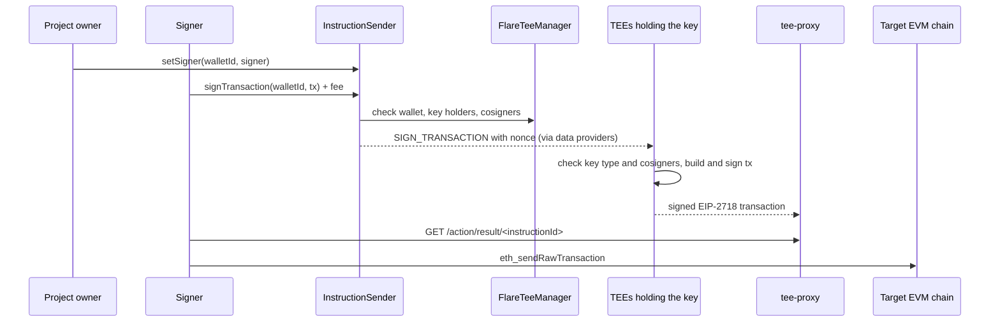

import CodeBlock from "@theme/CodeBlock";
import SignTransactionGo from "!!raw-loader!/examples/developer-hub-fcc-scaffold/examples/wallets/internal/app/signtransaction.go";
import InstructionSender from "!!raw-loader!/examples/developer-hub-fcc-scaffold/examples/wallets/contracts/src/InstructionSender.sol";

This guide walks through the [`wallets`](https://github.com/flare-foundation/fce-go-scaffold/tree/main/examples/wallets) example from the FCE Go scaffold.
The example signs EVM transactions with a **wallet key** that `tee-node` generates inside a TEE and never lets out.
A Flare contract decides who may use the wallet and numbers each transaction.
Every TEE that holds the key builds and signs the transaction, and posts it to its proxy, ready to broadcast.

The extension never sees the private key.
It asks `tee-node` to sign through the sign port, and only after it has checked that the key and the instruction match the wallet.

:::tip[New to FCC extensions?]
Start with [Build Your First Extension](/fcc/guides/getting-started) for `fce`, the template, and the deploy flow.
For the TEE identity key and how wallet keys differ from it, see [TEE public and private keys](/fcc/tee-keys).
:::

:::warning[An example, not production custody]
The key lives only in the memory of the TEEs that hold it.
A machine that restarts loses it until the key is restored from a backup.
Whoever holds the signer's key can have the TEE sign any transaction from the wallet.
The TEE checks nothing about the transaction except its chain ID: there are no limits and no simulation.
:::

:::info[Wallet setup is manual for now]
The `fce` CLI cannot set up wallets yet, so you cannot run this example end to end with `fce run` alone.
You can build and test it locally with `go test` and `fce conformance`, and follow the [onchain wallet setup](#setting-up-a-wallet) by hand.
Protocol Managed Wallets, the built-in FCC application for XRPL and Bitcoin, is a separate system that is [still in development](/fcc/overview#protocol-managed-wallets-pmw).
:::

## Overview

| Op type   | Op command         | Channel     | Payload                                                                    | Result                                                                     |
| --------- | ------------------ | ----------- | -------------------------------------------------------------------------- | -------------------------------------------------------------------------- |
| `WALLETS` | `SIGN_TRANSACTION` | Instruction | `abi.encode(bytes32 walletId, uint64 keyId, uint64 nonce, Transaction tx)` | The signed transaction: EIP-2718 bytes, ready for `eth_sendRawTransaction` |

The `Transaction` type is `(uint256 chainId, address to, uint256 value, bytes data, uint64 gas, uint256 maxFeePerGas, uint256 maxPriorityFeePerGas)`.
That is an EIP-1559 transaction without a nonce (which the contract assigns) and with an empty access list.
The example does not create contracts, so `to` is always a recipient.



## Wallets and Keys

An extension's wallets belong to **wallet projects**.
Each project has an owner, a key type, and a signing algorithm.
A wallet holds keys, and `tee-node` generates each key inside one TEE of the extension.
The extension never sees the keys, nor the instructions that create them.
It learns a wallet's ID and key ID only from its own payloads.

One key is one address, the same on every EVM chain.
This example therefore only accepts wallets with exactly one key, since two keys would sign from two different addresses.

The onchain side spans [`IWalletProjectManager`](/fcc/reference/IWalletProjectManager), [`IWalletManager`](/fcc/reference/IWalletManager), and [`IWalletKeyManager`](/fcc/reference/IWalletKeyManager), all served by the `FlareTeeManager` diamond.

## Who May Sign: The Contract

The wallet's project owner calls `setSigner(walletId, signer)`.
Setting the zero address stops the signer.
The signer then calls `signTransaction(walletId, transaction)`, paying at least `quoteSignTransaction(walletId)`.

The contract refuses the call unless all of the following hold:

- The caller is the wallet's signer.
- The chain ID isn't 0.
- The wallet's project belongs to this extension, with an `EVM` key that signs with `keccak256-secp256k1-ecdsa`.
- The wallet is in production, not paused.
- The wallet has exactly one key, and a production TEE holds it.

The contract then sends the instruction to every production TEE that holds the key, with the wallet's cosigners attached.
The fee is charged per TEE, so it rises when a restored key gains another holder.

<details>
  <summary>View the contract code</summary>
  <CodeBlock
    language="solidity"
    title="examples/wallets/contracts/src/InstructionSender.sol"
  >
    {InstructionSender}
  </CodeBlock>
</details>

## Checking in the TEE

Inside the TEE, `tee-node` signs with any key the TEE holds, regardless of the request.
It only checks that the instruction's own cosigners signed it.
So the extension checks the rest itself, using the key's info from the sign port (`tee.KeyInfo`):

- The key is an `EVM` key that signs with `keccak256-secp256k1-ecdsa`.
- The instruction's cosigners and threshold match the wallet's, compared the same way `tee-node` compares them for its own wallet operations.

Then the extension builds the EIP-1559 transaction from the fields and has the key sign it (`tee.SignWallet`).
It checks that the signature recovers to the key's address before returning the signed transaction.
The key only ever signs a transaction the extension built, never bytes a caller chose.

<details>
  <summary>View the handler code</summary>
  <CodeBlock
    language="go"
    title="examples/wallets/internal/app/signtransaction.go"
  >
    {SignTransactionGo}
  </CodeBlock>
</details>

The handler's refusals appear as `error: <text>` in the result log:

| Text                                      | When                                                              |
| ----------------------------------------- | ----------------------------------------------------------------- |
| `invalid payload`                         | The payload isn't exactly the contract's encoding                 |
| `chain id required`                       | `chainId` is 0                                                    |
| `wallet key not on this TEE`              | The TEE doesn't hold that key                                     |
| `not an EVM signing key`                  | The key has another type or algorithm, such as VRF                |
| `cosigners differ from the wallet's`      | The instruction's cosigners or threshold don't match the wallet's |
| `can't read the wallet key`, `can't sign` | `tee-node` failed, or the signature recovers to another address   |

## Nonces and Replacement

The contract numbers each wallet's transactions per chain, starting at 0.
Reading `nextNonce(walletId, chainId)` returns the next nonce.

Signing is deterministic: if an instruction is delivered again, it produces the same signed bytes, and the target chain accepts that transaction only once.
So the extension needs no replay protection and keeps no state.

A numbered transaction that never lands blocks every later transaction on that chain.
This can happen because of a lost instruction, a TEE that is down, a fee that is too low, or a balance that is too small.
Calling `replaceTransaction(walletId, nonce, transaction)` signs an already-numbered nonce again with new fields, for example to raise the fee or replace a transaction that never landed.
Both signed transactions stay valid and public until one of them lands.

## Broadcasting

The signed transaction appears on each key holder's proxy at `GET /action/result/<instructionId>`.
Anyone can broadcast it with `eth_sendRawTransaction` or `cast publish`.
The wallet's address pays the gas, so fund it on the target chain first.
The address comes from the key: read it with `getWalletKeyPublicKey`, or recover it from any transaction the key signed.

## Setting Up a Wallet

Until `fce` supports wallets, these are the onchain steps on the `FlareTeeManager` diamond:

1. As the extension owner, once: `addAllowedTeeWalletProjectOwners(extensionId, owners)` and `addSupportedKeyTypes(extensionId, ["EVM"])`.
2. As an allowed owner: `createProject(extensionId, "EVM", "keccak256-secp256k1-ecdsa")`, then `createWallet(projectId)`.
3. Call `setAdmins(walletId, publicKeys, threshold)`, then `confirmAdmin(walletId)` from each admin's address.
   Optionally call `setCosigners` and `confirmCosigner`.
   Then call `closeWalletInitialization(walletId)`.
4. Call `setMultisigThreshold(walletId, 1)`, then `addKey(teeId, walletId, claimBack)`, paying its fee.
   In that TEE, `tee-node` generates the key.
5. Read the key's existence proof, signed by the TEE, from its proxy, and call `confirmKey(proof, signature)`.
6. Call `enableWallet(walletId)`: the wallet goes into production, and no more keys can be added.
7. On the example contract: `setSigner(walletId, signer)`.

## Restarts and Backups

A TEE that restarts comes back as a new TEE, without its wallet keys.
Each key is backed up by `tee-proxy` in shares encrypted to the wallet's admins and to the data providers.
A restore puts the key on another TEE, either from the shares (which need the admins and the data providers) or directly from a TEE that still holds it.
The project owner, or its backup manager, then confirms the new holder with `confirmKey`.

Until then, no instruction reaches the new holder.
With no holder in production, `signTransaction` reverts with `ThresholdNotMet`.
A key that cannot be restored is lost.
Since you can't add a key to an enabled wallet, the only way out is a new wallet with a new address.

## Test Locally

```bash
go test ./examples/wallets/...
fce conformance ./examples/wallets
```

The fake sign port that the tests and `fce conformance` use holds one wallet key: wallet `keccak256("fakenode wallet")`, key 0, no cosigners.
That key is Anvil's second test account so that you can broadcast the first fixture's transaction on a local Anvil node:

```bash
anvil &
cast publish --rpc-url http://127.0.0.1:8545 "$(jq -r .result.data examples/wallets/conformance/1-sign-transfer.json)"
```

The forge tests send the fixtures' fields through the contract and check that it builds exactly the fixtures' payloads, so the contract and the handler cannot drift apart.

:::tip[What's next]

To learn more about FCC extensions, see:

- [TEE public and private keys](/fcc/tee-keys): the difference between the TEE identity key and wallet keys.
- [Data providers and cosigners](/fcc/data-providers): how cosigners add an authorization layer on top of data provider signatures.
- The scaffold's [contracts guide](https://github.com/flare-foundation/fce-go-scaffold/blob/main/docs/contracts.md#9-several-tees) on sending one instruction to several TEEs.
  :::
