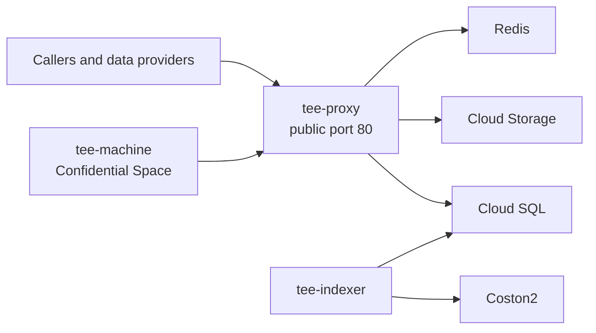

This guide runs an extension you already deployed with the [`fce`](https://github.com/flare-foundation/fce-tooling) command line tool on a real Trusted Execution Environment.
The Terraform in [`fcc-node-suite-deployment`](https://github.com/flare-foundation/fcc-node-suite-deployment) creates the virtual machines on a Google Cloud project you control: a Confidential Space **tee-machine**, a public **tee-proxy**, and a C-chain **indexer**.

The [`fce run`](/fcc/guides/getting-started) command stays on your own machine and attests tee-node's test code hash.
This stack boots the image `fce add-version` allowed, with `MODE` fixed at `0`, so the machine attests that image on the `GCP_AMD_SEV` platform.

:::tip[Finish the test flow first]
Complete [Build Your First Extension](/fcc/guides/getting-started) on Coston2, including a production version and governance, before you continue.
:::

:::warning[Work in progress]
FCC is in the final stages of development.
Use **Coston2** for this guide, and expect interfaces to change.
The `fce` command registers test machines.
The initial owner registers this machine on the [`FlareTeeManager`](/fcc/reference/IMachineManager) contract by hand.
The scaffold's [production draft](https://github.com/flare-foundation/fce-go-scaffold/blob/main/docs/production.md) lists the calls that are still being checked on a live machine.
:::

## Expected Outcome

The `terraform apply` command creates one stack in your project.
The tee-machine has no public IP.
It pulls work from tee-proxy inside the Virtual Private Cloud (VPC) and signs results with the key it generates at boot.



| Piece                       | What it does                                                                                                                                                                                                 |
| --------------------------- | ------------------------------------------------------------------------------------------------------------------------------------------------------------------------------------------------------------ |
| **tee-machine**             | Runs your image inside Confidential Space. Settings arrive as `tee-env-<KEY>` metadata, which the launcher turns into environment variables at boot.                                                         |
| **tee-proxy**               | Queues actions and stores results. The process listens on `6662`. The host publishes that as port **80**. Register `http://<static-ip>`.                                                                     |
| **tee-indexer**             | Indexes the C-chain into its own Cloud SQL database, which tee-proxy reads for signing policies and voters. You can point tee-proxy at [Flare's shared Coston2 indexer](#use-flares-shared-indexer) instead. |
| **Redis and Cloud Storage** | tee-proxy's queue and result store.                                                                                                                                                                          |
| **VPC and Cloud NAT**       | Give the private VMs a way out, so tee-machine can pull its image and call the attestation service.                                                                                                          |

Each directory under `envs/` is one stack.
`envs/example` is the blank template: copy it to a new directory, such as `envs/coston2-extension`, and fill in `terraform.tfvars` for your extension.
Leave `envs/example` unchanged so you can copy it again.

The `envs/coston2-sandbox` and `envs/coston-sandbox` directories run extension `0`, the stock tee-node image, on Coston2 and Coston.
The `envs/coston2-shielded-transfers` directory runs a custom extension on Coston2.

## Prerequisites

- A Google Cloud project with billing, and its **project ID** (`gcloud projects list`), which is `project` in `terraform.tfvars`.
- The [`gcloud` CLI](https://cloud.google.com/sdk/docs/install), authenticated as a user who can enable APIs and attach the runtime service account.
- [Terraform](https://developer.hashicorp.com/terraform/install) later than 1.11.
- [Python 3](https://www.python.org/downloads/) and [uv](https://docs.astral.sh/uv/getting-started/installation/) for `scripts/generate-key.sh`.
- Docker, to push the extension image.
- The Coston2 deployer from [Build Your First Extension](/fcc/guides/getting-started), still funded from the [Coston2 faucet](https://faucet.flare.network/coston2).
  Registration and the availability check charge fees, and each step pays gas.

:::danger[Keys and state]
The `terraform.tfstate` and `terraform.tfvars` files store the tee-proxy private key and the database passwords in plain text.
Keep both out of git.
For a stack you mean to keep, create a versioned Cloud Storage bucket and point the environment's `terraform.tf` at it before the first apply.
:::

## Step 1: Allow the Production Image

From your scaffold fork, allow the image on the platform this stack boots.
The module's default machine type is `c3d-standard-4`, an AMD SEV Confidential Space VM, so the platform is `GCP_AMD_SEV`:

```bash
fce add-version -chain coston2 -account coston2-deployer -platform GCP_AMD_SEV ./template
fce governance -chain coston2 -account coston2-deployer \
  -signers "$(cast wallet address --account coston2-deployer)" -threshold 1 ./template
fce status -chain coston2 ./template
```

The `fce add-version` command builds the image reproducibly and records its config digest in the `template/deployments/coston2.json` file.
Commit first so that anyone can rebuild that hash from your fork.
List every platform in this one command.
Adding a platform later means a new version label and a new hash.

The `fce deploy` command already allows the deployer to own the extension's machines.
The `initial_owner` variable below is that deployer address, because that account is the one that calls `register`.

Turn off the test version before real users arrive:

```bash
fce disable-version -chain coston2 -account coston2-deployer -test ./template
```

Disabling is permanent.
While the test hash is allowed, contracts accept signatures from test machines, whose operators hold the keys.

## Step 2: Push the Image

The `make image` command in the fork loads the image locally, as `fce/template`, and prints the config digest; `fce add-version` is allowed.
Confidential Space runs on an AMD SEV platform and pulls the `linux/amd64` architecture.
Tag that image and push it to your container registry:

```bash
IMAGE=ghcr.io/<your-account>/my-extension
docker tag fce/template "$IMAGE"
docker push "$IMAGE"
```

Copy the `sha256` digest from the push output.
The `terraform.tfvars` file pins the image by that digest, `ghcr.io/<your-account>/my-extension@sha256:<digest>`.
A tag can later point to a different image, which changes the measured code hash with no Terraform diff.

:::warning[Public vs. private images]
GitHub Container Registry creates the package as private on the first push.
The VM pulls with no registry login, so make the package public.
Making a package public is permanent.
:::

## Step 3: Set Up Google Cloud

Run this once per project.
The `gcloud` command uses your user credentials.
Terraform uses application-default credentials.
The scripts under `scripts/` call `gcloud` without `--project`, so they use the default project for the current user.
Replace `PROJECT_ID` in each command below and in `terraform.tfvars` with the project ID from `gcloud projects list`.

```bash
# Replace PROJECT_ID with your Google Cloud project ID.
gcloud auth login
gcloud auth application-default login
gcloud config set project PROJECT_ID

gcloud services enable \
  compute.googleapis.com \
  redis.googleapis.com \
  secretmanager.googleapis.com \
  confidentialcomputing.googleapis.com \
  sqladmin.googleapis.com \
  servicenetworking.googleapis.com \
  iap.googleapis.com \
  --project=PROJECT_ID
```

Both VMs run as one service account.
It needs `roles/confidentialcomputing.workloadUser`, or the launcher exits, plus log and metric writer roles.
Terraform grants `roles/storage.objectUser` on the bucket it creates.

```bash
# Replace PROJECT_ID with your Google Cloud project ID.
gcloud iam service-accounts create tee-runtime \
  --project=PROJECT_ID \
  --display-name="TEE runtime"

SA="tee-runtime@PROJECT_ID.iam.gserviceaccount.com"

for role in \
  roles/confidentialcomputing.workloadUser \
  roles/logging.logWriter \
  roles/monitoring.metricWriter
do
  gcloud projects add-iam-policy-binding PROJECT_ID \
    --member="serviceAccount:${SA}" \
    --role="$role" \
    --condition=None
done
```

The `--condition=None` flag grants the role across the project.
On a project that already uses conditional IAM bindings, `gcloud` asks for a condition on every new binding.
Choose `None`.
An existing condition limits the role to that one resource, and the launcher then exits without `roles/confidentialcomputing.workloadUser`.

Whoever runs Terraform needs `roles/iam.serviceAccountUser` on this account.
Project Editor plus that binding is enough to apply the stack.
To SSH later, the same identity needs the `roles/iap.tunnelResourceAccessor` role.
The VMs are reached through [IAP TCP forwarding](https://cloud.google.com/iap/docs/using-tcp-forwarding).

```bash
# Replace PROJECT_ID and YOU@example.com.
gcloud iam service-accounts add-iam-policy-binding "$SA" \
  --project=PROJECT_ID \
  --member="user:YOU@example.com" \
  --role="roles/iam.serviceAccountUser"
```

## Step 4: Configure the Environment

Copy the template environment and fill in `terraform.tfvars`:

```bash
git clone https://github.com/flare-foundation/fcc-node-suite-deployment.git
cd fcc-node-suite-deployment
cp -R envs/example envs/coston2-extension
cd envs/coston2-extension
cp terraform.tfvars.example terraform.tfvars
```

Generate a key for tee-proxy alone.
The script prints an address and a private key, and writes nothing to disk:

```bash
../../scripts/generate-key.sh
```

Put the private key in the `tee_proxy_private_key` variable.
Keep the address: it is the **proxy id** you pass to `register`.
Leave that key unfunded.
The `initial_owner` variable is the deployer, a different address from the deployment record.

Read the values `fce` already wrote from the scaffold fork:

```bash
jq '{extensionId, deployer, governance, flareTeeManager}' template/deployments/coston2.json
cast to-uint256 "$(jq -r .extensionId template/deployments/coston2.json)"
```

The `cast to-uint256` command prints the extension id as the 32-byte hex `extension_id` variable expects.
`deployer` is `initial_owner`.
The `governance.signers` and `governance.threshold` are `governance_signers` and `governance_threshold` variables.
The machine attests that set.
A mismatch reverts registration with an `InvalidGovernanceHash` error.

Resolve the four protocol contracts from the [Flare contract registry](/network/guides/flare-contracts-registry).
The registry address is the same across all Flare networks.
The `machine_path_manager` variable is `FlareTeeManager`, and it should match `flareTeeManager` in the deployment record:

```bash
RPC=https://coston2-api.flare.network/ext/C/rpc
REG=0xaD67FE66660Fb8dFE9d6b1b4240d8650e30F6019
for name in FlareSystemsManager VoterRegistry Relay FlareTeeManager; do
  cast call --rpc-url "$RPC" "$REG" \
    'getContractAddressByName(string)(address)' "$name"
done
```

The `envs/example/main.tf` file sets `tee_machine_debug_mode = true`.
That boots the debug Confidential Space image, redirects container logs to the serial console, and opens SSH through IAP (Identity-Aware Proxy).
The machine still has no public IP.
Data providers' verifiers refuse the debug image, so this first boot is only to confirm the workload starts.
[Step 6](#step-6-boot-the-production-image) replaces it with the production image before registration.

A filled-in `terraform.tfvars` for the template on Coston2 looks like this.
Take `tee_proxy_docker_image` from `terraform.tfvars.example` in the commit you cloned.
The stock tee-node tag in that file is for extension `0`.
Your extension replaces it with the digest from [Step 2](#step-2-push-the-image).

```hcl
project               = "PROJECT_ID" # replace with your project ID
service_account_email = "tee-runtime@PROJECT_ID.iam.gserviceaccount.com"
deploy_suffix         = "coston2-extension"

tee_node_docker_image  = "ghcr.io/<your-account>/my-extension@sha256:DIGEST"
tee_proxy_docker_image = "ghcr.io/flare-foundation/tee-proxy:v0.0.24"

tee_proxy_private_key = "0x..." # from generate-key.sh; do not fund it
initial_owner         = "0x..." # deployer in deployments/coston2.json

governance_signers   = ["0x..."] # governance.signers
governance_threshold = 1

extension_id = "0x..." # cast to-uint256 of extensionId

chain_id           = 114
chain_rpc_endpoint = "https://coston2-api.flare.network/ext/C/rpc"

flare_systems_manager = "0x..." # FlareSystemsManager
voter_registry        = "0x..." # VoterRegistry
relay                 = "0x..." # Relay
machine_path_manager  = "0x..." # FlareTeeManager
```

The `deploy_suffix` variable must be non-empty.
With `coston2-extension`, the VMs are named `tee-machine-coston2-extension` and `tee-proxy-coston2-extension`.
The example zone is `europe-west1-b` in the `terraform.tfvars` file.

### Use Flare's shared indexer

The copied example runs its own indexer on Cloud SQL.
tee-proxy can read Flare's shared Coston2 C-chain indexer, the same database the earlier guides put in the proxy `[db]` block:

```toml
[db]
host = "34.38.42.208"
port = 3306
database = "indexer"
username = "<your-indexer-db-username>"
password = "<your-indexer-db-password>"
```

:::info[Flare Indexer Access]
To get the shared indexer username and password, contact [support](https://flare.network/resources/technical-support) or [X](https://x.com/FlareDevs) and share what you are building.
:::

Point this environment at that database before `terraform apply`:

1. Uncomment the `indexer_db_*` variables in `variables.tf`.
2. In `main.tf`, comment out `module "tee_indexer"` and the three service-networking resources used only for Cloud SQL, then switch `tee_indexer_database` to the commented object that reads `var.indexer_db_*`.
3. Remove the `tee_indexer_instance_name` output from `outputs.tf` and the `indexer_drop_table_at_start` variable.
4. In `terraform.tfvars`, set `indexer_db_host` to `34.38.42.208`, and `indexer_db_user` and `indexer_db_password` to the credentials you were given.
   Port `3306` and database `indexer` are the defaults.

Keep the VPC, Cloud NAT, and router.
tee-machine has no public IP, so it still reaches the internet through Cloud NAT to pull its image and call the attestation service.

## Step 5: Apply and Check `/info`

```bash
terraform init
terraform apply
```

The apply creates the VPC, Cloud NAT, Redis, and the two TEE VMs.
With the bundled indexer, it also creates Cloud SQL and the indexer VM.
The shared indexer skips both.
When it finishes:

```bash
terraform output tee_proxy_info_url
curl -s "$(terraform output -raw tee_proxy_info_url)" | jq .
```

The `tee_proxy_info_url` variable is `http://<static-ip>/info`.
The `tee_proxy_external_endpoint` variable is that URL without `/info`, and it is the URL to register.

A healthy `machineData` for this extension should look like this:

| Field             | Expected                                                                                                                     |
| ----------------- | ---------------------------------------------------------------------------------------------------------------------------- |
| `platform`        | Begins with `0x4743505f414d445f534556` (`GCP_AMD_SEV`)                                                                       |
| `codeHash`        | The `codeHash` `fce add-version` wrote to `deployments/coston2.json`. The test hash `0x194844cf…` means a test image booted. |
| `extensionId`     | Your `extension_id`                                                                                                          |
| `initialOwner`    | The deployer address                                                                                                         |
| `teeInfo.chainId` | `114`                                                                                                                        |

The `initialSigningPolicyHash` and `lastSigningPolicyHash` fields become non-zero once the indexer has read a signing policy from the `Relay` contract.
The `attestation` and `dataSignature` fields are non-empty once the tee-machine has attested.
Signing-policy fields stay zero until the indexer catches up.
On the proxy VM, the `curl -s localhost:6661/ready` command names the failing check.
A `c-chain indexer delay` check result means the indexer is behind the chain tip.

While debug mode is on, tee-machine logs go to the serial console:

```bash
# Replace PROJECT_ID with your Google Cloud project ID.
gcloud compute instances get-serial-port-output \
  "$(terraform output -raw tee_machine_name)" \
  --zone europe-west1-b \
  --project PROJECT_ID
```

Look for `Node initialized.`
tee-proxy logs to systemd.
SSH goes through IAP:

```bash
# Replace PROJECT_ID with your Google Cloud project ID.
gcloud compute ssh "$(terraform output -raw tee_proxy_instance_name)" \
  --zone europe-west1-b \
  --project PROJECT_ID \
  --tunnel-through-iap
sudo journalctl -u tee-proxy -f
```

## Step 6: Boot the Production Image

Set `tee_machine_debug_mode = false` in the environment's `main.tf`.
Confidential Space reads workload metadata only at boot, and the boot disk image changes with the flag, so replace both VMs.
From the environment directory:

```bash
../../scripts/redeploy-proxy.sh
```

The script replaces tee-proxy and tee-machine together.
tee-machine's `PROXY_URL` is the proxy's internal IP, baked in at boot, and a replaced proxy can come back on a different internal address.
The public address is reserved and stays.
Replacing tee-machine generates a new key, so check `/info` again.
The `codeHash` and `platform` fields now come from the production image.

## Step 7: Register the Machine

Wait until `teeInfo.lastSigningPolicyId` has reached the chain's current reward epoch:

```bash
cast call --rpc-url "$RPC" <FlareSystemsManager> 'getCurrentRewardEpochId()(uint24)'
```

The initial owner then takes the machine to production with the same four steps [`fce run`](/fcc/guides/getting-started) performs for a test machine.
`fce` has no command that registers a machine it did not start.

1. Call [`register`](/fcc/reference/IMachineManager#register) on `FlareTeeManager` with the machine data and `dataSignature` from `/info`, the proxy id from [Step 4](#step-4-configure-the-environment), and `tee_proxy_external_endpoint` as the URL.
   Raise the signature's last byte by 27 before the call, which is what `fce run` does with a signature read from `/info`.
   Pay the `F_REG` / `TEE_ATTESTATION` fee.
   The receipt's `TeeInstructionsSent` event is the attestation challenge.
2. Wait until this proxy serves that instruction's result at `GET /action/result/<instructionId>?submissionTag=threshold` with status `1`.
3. Call [`requestAvailabilityCheckAttestation`](/fcc/reference/IVerification#requestavailabilitycheckattestation), naming a machine with extension `0` that is already in production.
   Pay that check's fee.
4. Call [`toProduction`](/fcc/reference/IMachineManager#toproduction) with the proof from that result, before the challenge expires.

The `fce send` command finds machines onchain, so it can target this machine once it is in production.
The `fce direct` and `fce stop` commands know only the machines `fce run` started.

An availability check lasts one reward epoch.
Renew it with [`confirmAvailability`](/fcc/reference/IVerification#confirmavailability) before it lapses.
The scaffold production draft records the renewal sequence that is still being checked on a live machine.
A machine whose check has lapsed stays in production until someone pauses it.

## Change a Running Stack

Cloud-init runs on first boot.
A later `terraform apply` can update metadata on a running VM while the guest keeps the old values.
Run these from the environment directory.

| Change                                                   | Command                             |
| -------------------------------------------------------- | ----------------------------------- |
| tee-proxy config, image, or any `tee-env-*` value        | `../../scripts/redeploy-proxy.sh`   |
| Indexer host, user, or password                          | `../../scripts/redeploy-proxy.sh`   |
| Bundled indexer start block, or a one-time database wipe | `../../scripts/redeploy-indexer.sh` |
| tee-proxy queue backed up                                | `../../scripts/flush-redis.sh`      |

A new workload image has a new `codeHash`.
Allow it with `fce add-version`, replace the machine, and register that boot.
Then turn off the old hash with `fce disable-version -hash <old hash>`, which pauses machines still on it.

Pause the machine, [`pause(teeId)`](/fcc/reference/IMachineManager#pause) from its owner, before you stop the VM.
Sends keep going to a machine that stays in production.
A stopped machine comes back as a new one, with a new key and empty state, and is registered again.

## Troubleshooting

| Symptom                         | What to check                                                                                                                                                                       |
| ------------------------------- | ----------------------------------------------------------------------------------------------------------------------------------------------------------------------------------- |
| Launcher exits with code 4      | Every `tee-env-*` key is on the image's `tee.launch_policy.allow_env_override` label. The runtime service account has `roles/confidentialcomputing.workloadUser`.                   |
| Image pull fails                | The `ghcr.io` package is public.                                                                                                                                                    |
| `codeHash` is `0x194844cf…`     | The production image booted, with `MODE` fixed at `0` in the Dockerfile. A test image is still what the VM pulled.                                                                  |
| `extensionId` is all zeros      | `extension_id` is set, and tee-machine was replaced after you set it.                                                                                                               |
| `InvalidGovernanceHash`         | `governance_signers` and `governance_threshold` match `governance` in `deployments/coston2.json`.                                                                                   |
| `connecting to database`        | With the bundled indexer, wait for Cloud SQL and the indexer VM. With the shared indexer, check `indexer_db_host`, `indexer_db_user`, and `indexer_db_password`.                    |
| Signing-policy hashes stay zero | `relay` is the live `Relay` from the contract registry. Wait until the indexer has seen a `SigningPolicyInitialized` log.                                                           |
| `/info` never answers           | tee-proxy logs (`journalctl -u tee-proxy`) and the serial console while debug mode is on. The public URL is port 80. tee-machine reaches tee-proxy on port **6661** inside the VPC. |
| `/ready` reports indexer delay  | The indexer is behind the chain tip. Wait, then check again. For the bundled indexer, also check `journalctl -u tee-indexer`.                                                       |
| Queue depth keeps growing       | tee-proxy enqueues a TEE info action while tee-machine is down. After the machine is back, run `../../scripts/flush-redis.sh`.                                                      |

The repository's [`TESTING.md`](https://github.com/flare-foundation/fcc-node-suite-deployment/blob/main/TESTING.md) covers the internal `/healthy`, `/startup`, and `/ready` checks.
[`modules/tee-package/README.md`](https://github.com/flare-foundation/fcc-node-suite-deployment/blob/main/modules/tee-package/README.md) describes each variable.

:::tip[What's Next]

Try continuing to build with Flare Confidential Compute; follow these guides:

- [FCC Troubleshooting](/fcc/troubleshooting): `fce` and machine issues, including a protocol redeploy.
- [TEE public and private keys](/fcc/tee-keys): the identity key this machine generates at boot.
- [Data providers and cosigners](/fcc/data-providers): why the availability check and later instructions wait on signing weight.
  :::
