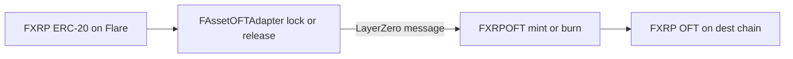

FXRP is deployed as a LayerZero [Omnichain Fungible Token (OFT)](https://docs.layerzero.network/v2/home/token-standards/oft-standard).
Flare is the home chain: **`FAssetOFTAdapter`** wraps the existing FXRP ERC-20 and locks or releases it.
Every other EVM chain runs **`FXRPOFT`**, which mints and burns a native OFT so the global supply stays unified.

Addresses and verified contract source live on the [OFT deployments](/fxrp/oft#deployments) table.

:::info
Guides on this site default to **Coston2**.
Use the Coston2 adapter for testnet examples and the Flare adapter for production.
:::

## How It Works

On Flare networks (Mainnet or Testnet), a user (or a contract they authorize) calls `send` on the adapter.
The adapter pulls FXRP from the sender with `transferFrom` — that is the lock — and dispatches a LayerZero message.
On the destination chain, the peer `FXRPOFT` mints the equivalent amount to the recipient after [DVNs](/fxrp/oft#dvn-security-stack) verify the message.

The reverse path burns `FXRPOFT` on the remote chain and releases FXRP from the adapter on Flare.

FXRP uses **6 decimals everywhere**, matching LayerZero shared decimals, so transfers carry no dust.

LayerZero's default OFT Adapter assumes lossless inner-token transfers.
Only **one** adapter should exist for a given FXRP mesh.

| Chain            | Contract           | What a send does                                       |
| ---------------- | ------------------ | ------------------------------------------------------ |
| Flare, Coston2   | `FAssetOFTAdapter` | Locks (or, inbound, releases) the existing FXRP ERC-20 |
| Other EVM chains | `FXRPOFT`          | Burns (or, inbound, mints) the native OFT              |

`FXRPOFT` is a thin `FAssetOFT` whose `decimals()` is fixed at `6`.
Both contracts inherit the same Flare extensions: transfer limits, pause, and recipient checks.

Sending from the adapter requires an ERC-20 `approve` of the inner FXRP token.
Sending from `FXRPOFT` burns the local OFT instead, so there is no inner-token approval.

## Flare-Specific Behavior

These modules sit on top of LayerZero's OFT surface.
They apply to both `FAssetOFTAdapter` and `FXRPOFT`.

### Transfer Limits

Each contract enforces independent **outgoing** (per destination endpoint ID) and **incoming** (per source endpoint ID) sliding-window caps.
`send` records the outgoing amount on the source contract; credit records the incoming amount on the destination contract.
A transfer that does not fit the remaining capacity reverts with [`RateLimitExceeded`](/fxrp/oft/fxrp-oft-transfer-limits#ratelimitexceeded).

[`quoteOFT`](/fxrp/oft/reference/FAssetOFTAdapter#quoteoft) exposes remaining send capacity as `oftLimit.maxAmountLD = min(amountCanBeSent, totalSupply)`.

See [Check OFT Transfer Limits](/fxrp/oft/fxrp-oft-transfer-limits) for the getters, fallback rules, and a Coston2 read-only example.

### Pause

`ExternalPausable` gates `_debit` and `_credit` with `whenNotPaused`.
While paused, sends and credits revert; reads still work.

The owner, or any address in the pause-sender set, can call `pause` and `unpause`.
`pauseSenders()` lists the registered senders and does not include the owner, who is always authorized.

### Recipient Checks

LayerZero carries the recipient as an opaque `bytes32`.
A malformed `to` cannot be recovered once the message is in flight, so `_send` checks the recipient against the destination peer **before** debiting.

- A zero recipient reverts with `ZeroRecipient`.
- The recipient must use the same address shape as the destination peer: an EVM peer is a 20-byte address left-padded to 32 bytes; a Solana peer uses all 32 bytes.
- A mismatch reverts with `RecipientFormatMismatch`.

For EVM destinations, left-pad the recipient address to 32 bytes (as the [bridge guide](/fxrp/oft/fxrp-bridge-ethereum) does with `pad(recipient, { size: 32 })`).

### Fee

[`quoteOFT`](/fxrp/oft/reference/FAssetOFTAdapter#quoteoft) reports the whole difference between the sent amount and the received amount as a single `"Flare system fee"` line item (BPS fee plus any de-dust remainder).
[`quoteSend`](/fxrp/oft/reference/FAssetOFTAdapter#quotesend) returns the LayerZero message fee to attach as `msg.value`.

The stored rate is [`defaultFeeBps`](/fxrp/oft/reference/FAssetOFTAdapter#defaultfeebps), unless [`feeBps`](/fxrp/oft/reference/FAssetOFTAdapter#feebps) enables a per-destination override.
[`getFee`](/fxrp/oft/reference/FAssetOFTAdapter#getfee) applies that rate to an amount.
Fees already collected on the contract are [`feeBalance`](/fxrp/oft/reference/FAssetOFTAdapter#feebalance).

A worked quote of the token fee, the LayerZero message fee, and the DVN portion is in [OFT Fees](/fxrp/oft/fxrp-oft-fees).

Signatures for `send`, `quoteSend`, `quoteOFT`, the fee getters, `peers`, and pause are in the [FAssetOFTAdapter reference](/fxrp/oft/reference/FAssetOFTAdapter).

Transfer-limit getters (`getAmountCanBeSent`, `getAmountCanBeReceived`, and the raw per-eid / default config reads) and the [`RateLimitExceeded`](/fxrp/oft/fxrp-oft-transfer-limits#ratelimitexceeded) error are documented in [Check OFT Transfer Limits](/fxrp/oft/fxrp-oft-transfer-limits).

:::tip[What's next]

- Read the token fee and the LayerZero message fee in [OFT Fees](/fxrp/oft/fxrp-oft-fees).
- Read remaining capacity with [Check OFT Transfer Limits](/fxrp/oft/fxrp-oft-transfer-limits).
- Bridge from Coston2 to Sepolia in [Bridge FXRP to Ethereum](/fxrp/oft/fxrp-bridge-ethereum).
- Bridge and auto-redeem from Hyperliquid in [FAsset Auto-Redemption](/fxrp/oft/fxrp-autoredeem).

:::
