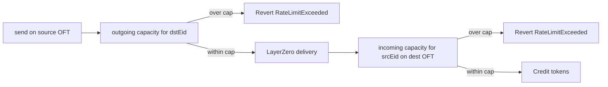

import CodeBlock from "@theme/CodeBlock";
import getOftTransferLimits from "!!raw-loader!/examples/developer-hub-javascript/getOftTransferLimits.ts";

## Overview

FXRP OFT transfers are capped by **per-endpoint sliding-window rate limits** on the OFT contracts themselves.
These are **not** the FAssets [minting rate limits](/fassets/developer-guides/fassets-mint-limits) on `AssetManager`.

The same view API lives on:

- **`FAssetOFTAdapter`** on Flare and Coston2 (lock/release)
- **`FXRPOFT`** on other chains (mint/burn)

See [FXRP OFT Adapter](/fxrp/oft/fxrp-oft-adapter) for how those contracts relate, and [OFT deployments](/fxrp/oft#deployments) for addresses.

A send records outgoing capacity on the **source** contract for the destination LayerZero endpoint ID (EID).
Credit records incoming capacity on the **destination** contract for the source EID.
The two directions do not refill each other.
A transfer that does not fit remaining capacity reverts with [`RateLimitExceeded`](#ratelimitexceeded).
That is a custom error, not an event: the call fails, and no log is emitted.



The practical getters are `getAmountCanBeSent` and `getAmountCanBeReceived`.
They apply the default fallback and linear decay, so they are what you should call before `send()`.

This example queries the **Coston2** adapter `0xCd3d2127935Ae82Af54Fc31cCD9D3440dbF46639` for Sepolia EID `40161`.
On mainnet, call the Flare adapter or the destination `FXRPOFT` instead.

## Query Functions

All six functions are `view`.
Anyone can call them; no wallet is required.

| Goal                       | Function                                 | What it returns                                                           |
| -------------------------- | ---------------------------------------- | ------------------------------------------------------------------------- |
| Per-eid outgoing config    | `outgoingRateLimit(uint32 _dstEid)`      | Raw `RateLimit` storage. `window == 0` means "use default", not unlimited |
| Per-eid incoming config    | `incomingRateLimit(uint32 _srcEid)`      | Raw `RateLimit` storage                                                   |
| Default outgoing           | `defaultOutgoingRateLimit()`             | Fallback when the per-eid outgoing window is `0`                          |
| Default incoming           | `defaultIncomingRateLimit()`             | Fallback when the per-eid incoming window is `0`                          |
| Remaining send capacity    | `getAmountCanBeSent(uint32 _dstEid)`     | `(consumed after decay, amountCanBeSent)`                                 |
| Remaining receive capacity | `getAmountCanBeReceived(uint32 _srcEid)` | `(consumed after decay, amountCanBeReceived)`                             |

```solidity
struct RateLimit {
    uint192 consumedTransferCapacity;
    uint64 lastUpdated;
    uint192 limit;
    uint64 window;
}

struct DefaultRateLimit {
    uint192 limit;
    uint64 window;
}

function outgoingRateLimit(uint32 _dstEid) external view returns (RateLimit memory);
function incomingRateLimit(uint32 _srcEid) external view returns (RateLimit memory);
function defaultOutgoingRateLimit() external view returns (DefaultRateLimit memory);
function defaultIncomingRateLimit() external view returns (DefaultRateLimit memory);
function getAmountCanBeSent(uint32 _dstEid)
    public view returns (uint256 currentConsumedTransferCapacity, uint256 amountCanBeSent);
function getAmountCanBeReceived(uint32 _srcEid)
    public view returns (uint256 currentConsumedTransferCapacity, uint256 amountCanBeReceived);
```

`limit` and remaining capacity are in **token base units**.
FXRP uses 6 decimals, so `1_000_000` is 1 FXRP.

`window` is the duration in seconds.
Capacity refills with linear decay at `limit / window` per second:

```text
decay = limit * timeSinceLastUpdate / window
consumed = max(0, consumedTransferCapacity - decay)
remaining = max(0, limit - consumed)
```

[`quoteOFT`](/fxrp/oft/reference/FAssetOFTAdapter#quoteoft) also surfaces remaining send capacity as `oftLimit.maxAmountLD = min(amountCanBeSent, totalSupply)`.

## Which Contract to Call

Call the OFT on the chain that enforces capacity.

| Question                                         | Call on                    | Function                        |
| ------------------------------------------------ | -------------------------- | ------------------------------- |
| How much can I send from Coston2 to Sepolia?     | Coston2 `FAssetOFTAdapter` | `getAmountCanBeSent(40161)`     |
| How much can Coston2 still receive from Sepolia? | Coston2 `FAssetOFTAdapter` | `getAmountCanBeReceived(40161)` |
| How much can I send from Sepolia to Coston2?     | Sepolia `FXRPOFT`          | `getAmountCanBeSent(40294)`     |
| How much can Sepolia still receive from Coston2? | Sepolia `FXRPOFT`          | `getAmountCanBeReceived(40294)` |

A full preflight for Coston2 → Sepolia reads **both** legs: outgoing on the adapter and incoming on Sepolia `FXRPOFT`.
The script below reads one contract (the Coston2 adapter) so you can see every getter in one place.

Coston2 EID is `40294` (`EndpointId.FLARE_V2_TESTNET`).
Sepolia EID is `40161` (`EndpointId.SEPOLIA_V2_TESTNET`).
Mainnet Flare is `30295`.

## Fallback Rules

A per-eid entry is configured only when its `window > 0`.

| Per-eid `window`   | Default `window` | Effective behavior                                                        |
| ------------------ | ---------------- | ------------------------------------------------------------------------- |
| `> 0`              | anything         | Use the per-eid `limit` / `window`                                        |
| `0`                | `> 0`            | Fall back to the default                                                  |
| `0`                | `0`              | Limiting **disabled**: `getAmountCanBe*` returns `(0, type(uint256).max)` |
| `> 0`, `limit = 0` | —                | **Blocked**: remaining capacity is `0`                                    |

`outgoingRateLimit` / `incomingRateLimit` return stored `limit` / `window` as-is.
If `window == 0`, that means "use default", not "unlimited".
Use `getAmountCanBeSent` / `getAmountCanBeReceived` for effective remaining capacity.

Rate-limit configuration (`setOutgoingRateLimits`, `setDefaultOutgoingRateLimit`, and the incoming equivalents) is owner/governance only.

## Transfer Limits Script

<CodeBlock language="typescript" title="getOftTransferLimits.ts">
  {getOftTransferLimits}
</CodeBlock>

## How to Run

```bash
npx tsx getOftTransferLimits.ts
```

Change `DST_EID` to another LayerZero V2 testnet EID, or point `COSTON2_OFT_ADAPTER` and the client at Flare mainnet to query production.

## Expected Output

Values change as transfers consume capacity and as that consumption decays.
In the snapshot below, Sepolia has no per-eid window, so the defaults apply.
After decay, remaining outgoing capacity is the default outgoing limit (1,000,000 FXRP over 3600s) and remaining incoming capacity is the default incoming limit (1,500,000 FXRP over 3600s):

<details>
  <summary>Expected Output</summary>
```text
=== FXRP OFT Transfer Limits ===

OFT Adapter: 0xCd3d2127935Ae82Af54Fc31cCD9D3440dbF46639
Network: Coston2
Remote EID: 40161 (Sepolia)

outgoingRateLimit(40161):
consumed: 10000000 (10 FXRP)
lastUpdated: 1790081729
limit: 0 (0 FXRP)
window: 0s (use default)
defaultOutgoingRateLimit():
limit: 1000000000000 (1000000 FXRP)
window: 3600s
incomingRateLimit(40161):
consumed: 1000000 (1 FXRP)
lastUpdated: 1790081154
limit: 0 (0 FXRP)
window: 0s (use default)
defaultIncomingRateLimit():
limit: 1500000000000 (1500000 FXRP)
window: 3600s

getAmountCanBeSent(40161):
consumed (after decay): 0 (0 FXRP)
remaining: 1000000000000 (1000000 FXRP)
note: per-eid window is 0, so the default outgoing limit applies

getAmountCanBeReceived(40161):
consumed (after decay): 0 (0 FXRP)
remaining: 1500000000000 (1500000 FXRP)
note: per-eid window is 0, so the default incoming limit applies

````

Raw `outgoingRateLimit` can still show leftover `consumedTransferCapacity` while `getAmountCanBeSent` reports `0` consumed after decay.
That is expected: the raw getter does not apply decay or the default fallback.
</details>

## Code Breakdown

1. **Client.**
   A Viem `publicClient` on `flareTestnet` is enough.
   The script never creates a wallet client.
2. **Target.**
   `COSTON2_OFT_ADAPTER` is the documented Coston2 adapter.
   `DST_EID` is Sepolia (`EndpointId.SEPOLIA_V2_TESTNET`, `40161`), matching [Bridge FXRP to Ethereum](/fxrp/oft/fxrp-bridge-ethereum).
3. **ABI.**
   Only the six `TransferLimiting` view functions are inlined.
   They are not in `@flarenetwork/flare-periphery-contracts`.
4. **Raw vs effective.**
   `outgoingRateLimit` / `incomingRateLimit` plus the defaults show the configured windows.
   `getAmountCanBeSent` / `getAmountCanBeReceived` apply the fallback and decay.
5. **Units.**
   Amounts print as base units and as FXRP via `formatUnits(..., 6)`.
   `type(uint256).max` remaining prints as `unlimited`.

## RateLimitExceeded

`RateLimitExceeded` is a Solidity custom **error**, not an event.
When remaining capacity is too small, `_record` reverts and the transfer does not happen.
There is no delay, no retry timestamp, and no `RateLimitExceeded` log to watch.

```solidity
error RateLimitExceeded();
````

The error has no arguments.
Remaining capacity is not in the revert data — call [`getAmountCanBeSent`](#query-functions) or [`getAmountCanBeReceived`](#query-functions) before `send()`.

| Where it reverts                 | Cause                                                                        |
| -------------------------------- | ---------------------------------------------------------------------------- |
| Source `send`                    | Outgoing remaining capacity for `_dstEid` is below the amount being sent     |
| Destination credit (`lzReceive`) | Incoming remaining capacity for `_srcEid` is below the amount being credited |

Wallets and explorers show a failed transaction with this custom error.
Unlike [minting rate limits](/fassets/developer-guides/fassets-mint-limits), which delay execution, an OFT transfer that hits the cap is rejected outright.

## Important Notes

- **Call the contract on the chain you care about.**
  Outgoing capacity for Flare → Base is on the Flare adapter; incoming capacity for that same transfer is on Base `FXRPOFT`.
- **Raw per-eid reads are not remaining capacity.**
  `window == 0` means "use default". Always prefer `getAmountCanBeSent` / `getAmountCanBeReceived` for preflight.
- **Overflow reverts.**
  `send` and credit revert with [`RateLimitExceeded`](#ratelimitexceeded) when the amount does not fit.
- **Paused sends also revert.**
  Check `paused()` on the adapter if a send fails for a reason other than the rate limit.
  See [FXRP OFT Adapter](/fxrp/oft/fxrp-oft-adapter#pause).

:::tip[What's next]

- Read the adapter surface in [FXRP OFT Adapter](/fxrp/oft/fxrp-oft-adapter).
- Bridge from Coston2 to Sepolia in [Bridge FXRP to Ethereum](/fxrp/oft/fxrp-bridge-ethereum).
- Bridge and auto-redeem from Hyperliquid in [FAsset Auto-Redemption](/fxrp/oft/fxrp-autoredeem).

:::
